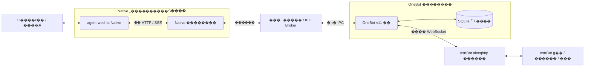

# MukPun-WeChat

**�� Linux ������΢���� AstrBot �� OneBot v11 ת���š�**

����Ŀʹ�ù̶��汾�� [agent-wechat Native](https://github.com/thisnick/agent-wechat/releases/tag/v1.0.0-beta.8) ���ա�����΢����Ϣ��������Ⱥ�ĺ�ָ��˽��ת��Ϊ OneBot v11 �¼���ͨ������ WebSocket �������� AstrBot��

AI ģ�͡��˸������ĺͲ���� AstrBot �������Ÿ�����Ϣ���䡢����ӳ�䡢·�ɡ�ͼƬ������ȥ�غͷ��ͻ�ִ��**�����е��� LLM��Ҳ������ģ�� API Key**��

> ��ǰ�汾Ϊ����ʵ���˺���֤������������ʵ�֣���������ʵ����ص�Ŀ¼���ֺ���֤���ߣ��в���һ����װ�������˺Ż����������е�ͨ�÷��а档�����ֿ��е��������û�����ϵ����Ϣ��Ϊʾ��ֵ��

## ���ܸ���

| ���� | ��ǰʵ�� |
| --- | --- |
| ʵʱ��Ϣ���� | �������� Native SSE��У���αꡢ�¼�ժҪ����Ϣ����ʹ���ʱ�� |
| Ⱥ����˽�� | �Զ���������Ⱥ�������¼����Ⱥ����˽���԰�ָ����ϵ�� |
| AI �ظ� | ΢����Ϣ���� AstrBot�������������õ�ģ�ͺͲ�� |
| Ⱥ�������� | �ϱ�����Ⱥ��ͨ�ı����� AstrBot �������ˡ����Ѽ��ظ� |
| Ⱥ�Ļ��� | ������ʵ `@������`������ԭ�Ľ��� AstrBot ���� |
| Ⱥ��Ա���� | ͸���ѻ������ʵ�dzƺ�Ⱥ��Ƭ�������ȶ��û� ID������ȱʧʱʹ��ռλ�� |
| ͼƬ���� | ����ͨͼƬ���������⽻�� AstrBot��֧��ͬ�Ự���á�ͬ��ԱȺͼ���� |
| ��̬ͼƬ��� | ֧�ֵ��� PNG��JPEG����̬ WebP��ʵ��˽�ġ�Ⱥ�ļ� AstrBot �����ͼ����֤ |
| ���ı� | У�� UTF-8 �ֽڳ��ȣ������޷ֶΣ����η��Ͳ��˶Ի�ִ |
| ��ѭ�� | ��ʵ���� senderId У�顢������ˡ���Ϣ ID ȥ�ء��־ö���ȥ�� |
| ������ָ� | SQLite �н��ת�����С��־�����ӳ�䡢�α걣��Ͳ�ȷ��������� |
| ��¼�Ự���� | �������Ͽ��ռ��������ϻָ�·�������ӹ��ϲ��Զ��˻�ɨ�� |
| ״̬����� | CLI ״̬������/����/�޶�ָ�ꡢ�����ĵ�ͼƬ�ܾ�ԭ�����սű� |
| WebUI / �������� | ��δʵ�֣����������滮 |

�Ų�ʵ����Ϣ����ϲ�����Ҫ�ϲ�������Ϣ��Ⱥ�ķ����������ظ�ʱ������ AstrBot �� `chat_plus` �Ȳ�����������������ظ��ϲ���

## �ܹ�



### ����ְ��

| �� | ��Ҫģ�� | ְ�� |
| --- | --- | --- |
| Э������Ϣת�� | `protocol.py`��`continuous.py`��`group_trigger.py` | OneBot �¼�/API������У�顢Ⱥ/˽��·�ɡ��������ı��ֶ� |
| �־û� | `state.py`��`durable.py` | �ȶ����� ID��������С��αꡢ�Ự·�ɺ����ύ������� |
| OneBot ���� | `transport.py`��`forward_gateway.py` | ��Ȩ���� WS����������/������IPC �����������ִ�� |
| Native ���� | `forward_native_worker.py`��`forward_sse.py` | SSE ���ġ��Զ�ʶ��Ⱥ·�ɡ���ʵ��Ϣ��ȡ��������Ϣ���� |
| ͼƬ���� | `image_native.py`��`image_input.py` | �н�ȡͼ��ͼƬ���ú�Ⱥ��ͬ��Ա������� |
| ��Ա���� | `sender_names.py`��`state.py` | �������˾�ȷ��ѯ�dzơ�Ⱥ��Ƭ����ʱ����ͳ־û���ѯ |
| ͼƬ��� | `image_output.py`��`image_send_native.py` | ��ʽ/��СУ�顢�ֿ���װ���ϴ���������ҵ��ý��ͶӰ���� |
| ��������� | `run_forwarder.py`��`run_private_forwarder.py`��`media_egress.py` | ���� systemd ���񡢽���/��Դ��顢���� IPC����ʱý���������� |
| �Ự���� | `session_runtime*.py`��`session_state_store.py` | �������Ͽ��ա��Ự�ָ�����ֹ�Զ� fresh login |

### ��վ��΢�� �� AstrBot

1. Native �������̶��� SSE��������ʵ�¼���ȡ��Ϣ��
2. У���˺š�Ⱥ·�ɡ���Ϣ���򡢴���ʱ�估�α�ժҪ������������Ϣ����ʷ�طš�
3. ͼƬ���ⰴͬ�Ự���ã���Ⱥ��ͬһ��Ա�Ĺ�������׼��ý�塣
4. ��Ϣͨ���н����� IPC ���� OneBot �������̣���д��־ö�����ȷ���αꡣ
5. ת��Ϊ OneBot `message` �¼������ȶ����û���Ⱥ����Ϣ���� ID��
6. ͨ������ WebSocket �ϱ� AstrBot��ģ����ظ������� AstrBot ������

Ĭ������ `allGroupsEnabled`������Ⱥ����ͨ�ı�ֱ���ϱ�����ͨ��Ϣ�� `/ai` ���ᱻα��� `@`��Ҳ����д����ԭ�ġ�Ⱥ��Ϣ���� AstrBot ������ÿ�����������ģ�ͣ�ʵ����Ϊȡ���� AstrBot �Ͳ�����á�

### ��վ��AstrBot �� ΢��

1. У�� OneBot action��`echo`��Ŀ�� ID �ͳ־�Ⱥ·�ɣ�Ⱥ�ظ������� AstrBot ������˽�ı�����ǰ�Ự�ظ����ڡ�
2. У��������Ϣ������ǰ֧���ı������ž�̬ͼƬ��ͬ�Ự���á�
3. �־�Ԥ���������ݵȼ�����ͬ�����ظ�����ʱ���ػ������������·��͡�
4. �ı����ֽ����޷ֶΣ�ͼƬ����Ҫ�ֿ鴫�䣬����У���ŵ��� Native��
5. ���� POST ֻ�ύһ�Σ�������ȡ�Ѱ���ҵ״̬������ʱ�Զ��ط���
6. �ɹ��뾭�����������ܻ�ִ����Ҫ����ϢͶӰ���飻ͼƬ��У��ԴժҪ��ý���ϴ����غ�����ý��ժҪ��

����״̬��Ϊ���ࣺ

| ״̬ | ���� |
| --- | --- |
| ��ȷ�Ͻ��� | ���سɹ������������ȶ���Ϣ ID |
| ��ȷ��δ�ύ / �ύǰʧ�� | ��ȷ����ʧ�ܲ�����ȥ�ؼ�¼�����������ı�ת�� |
| �ѽ����ύ�׶ε�������� | ������ƺʹ��˶�״̬�����Զ��ط�����Ҫʱֹͣ�ŵȴ��˶� |

�������ط�����ҵ�ɹ�������΢����Ϣ���ͳɹ����ر��� SDK �� `preparing`��`uploading`��`readback` �׶ε�ȷ��ʧ�ܣ������������ύ���δ֪�����Ϊһ̸��

## OneBot v11 ֧�ַ�Χ

��ǰʵ�����㱾��Ŀ�� AstrBot ����������Ӽ���**�������� OneBot v11 ʵ��**��

| API / �¼� | ��Χ |
| --- | --- |
| `send_msg`��`send_private_msg`��`send_group_msg` | ��ʶ���Ⱥ��ָ��˽�ģ��ı������޵�ͼ������ `echo` ���� |
| `get_login_info`��`get_status`��`get_version_info` | ��ǰ�����ݡ�����״̬�Ͱ汾��Ϣ |
| `get_friend_list` | ָ��������ϵ�ˣ���������΢�ź����б� |
| `get_group_list`��`get_group_info` | �ѹ۲쵽��Ϣ��Ⱥ����Ⱥ������Ϣ�Զ������ȶ�·�� |
| `get_group_member_info`��`get_stranger_info` | �ѹ۲��Ա���dzƺ�Ⱥ��Ƭ������ȱʧʱ����ռλ�������ṩ������ԱĿ¼ |
| `can_send_image` | ��ӳ��̬��ͼ������أ����ܸ�ʽ����Դ���� |
| `can_send_record` | `false` |
| `message` | Ⱥ/˽���ı�����֧�ֵ�ͼƬ���⡢ԭ�� @ ��Ϣ |
| `meta_event` | �������ڼ����� |

��פģʽû��������ʷ��Ϣ���������ڵ��ִ����е� `get_msg` ������Ϊ������ʷ API��Ⱥ��������Աȫ���б�������/֪ͨ�¼����ϲ�ת��������/��Ƶ�������δʵ�֡���֧�ֵ� action ����Ϣ�λ���ȷ����ʧ�ܣ���α��ɹ���

## ͼƬ����������

### ���� AstrBot

- ֧����ͨͼƬ��Ϣ��ͬ�ỰͼƬ���á�
- Ⱥ�ڿɽ�ͬһ��Ա 90 ���ڵ�ͼƬ�뻽��������������ⲻͬ��Ա��ͼƬ����һ��
- ��ͼ�������� **128KiB**������ʹ�úϹ滺��ͼ����Ҫʱȡ����ͼ��
- ͼƬʶ������ AstrBot ģ�ͼ�������Ӿ����ã��Ų�����ͼƬ������
- ΢��ԭ�� `type47` ����������ݻ�����������ͬ����ͨͼƬ���롣

### �����΢��

- ֧�ֵ��� **PNG��JPEG����̬ WebP**��Դ�ļ���� **2MiB**��
- ���߷ֱ𲻳��� **2048**�������ز����� **2 �� 1024 �� 1024**������ 2048��2048 �������������ơ�
- OneBot ͼƬԴʹ�� `base64://`���Ų���ȡ AstrBot �ļ�·������������ͼƬ URL��
- WebSocket action ���� **4MiB**���ڲ� IPC ��֡��Ϊ **256KiB**����ͼԭʼ���ݰ� **64KiB** �ֿ鲢���ȷ�ϡ�
- PNG ������ʽ�н��ѹУ�飬��֤ CRC���ߴ缰ɨ���У��ܾ� APNG��WebP �ܾ�������ǡ�
- Native SDK �����ز�����תΪ JPEG��Դ�ļ��ֽڲ���֤ԭ��������
- GIF����ͼ��ԭ�� sticker����ͼ��ͼ�Ļ�����δ֧�֡�

�̶� beta SDK �Բ����ز��Կ�����ͼƬ׼���׶η���ʧ�ܡ���֪�ύǰʧ���ֲ����ж��ı��ţ�δ֪�ύ�����ִ�д��˶Ա�����

ͼƬ�ϴ�����**�ۼ� 16 ��������Ԥ��**��������Ԥ����ʧ�ܳ��ԣ�������ڴ桢���ݿ��ļ��ʹ洢�������ﵽԤ��������ż����ܾ����ϴ�����δʵ�� SDK ý�建��İ�ȫ���գ�����ͨ��ɾ�������е����ݿ���������Ԥ���ƹ����ơ�

## �ɿ�������Դ����

### ��ѭ�����ظ�����

- ���˳�վ�¼�����ʵ���� senderId��������������������ʾ����
- ����ԭʼ��Ϣ ID��ժҪ�ͳ־��α�ȥ�ء�
- ʹ�� SQLite ����Ự·�ɡ��������ݼ����Ͷ����������������������ӳ�䡣
- ���Ͷ�������Ŀ��Ự��������Ϣ�� `echo`��ʹ���ȶ� Native �ݵȼ���
- ���ͽ��δ֪ʱ���Զ����ԣ����Ѿ����⾲Ĭ���½���ģ�͡�

### �н�״̬

| ��Ŀ | ��ǰ���� |
| --- | --- |
| ��ת������ | ��� 32 �� / 2MiB |
| �����ı� | ��� 32KiB��Ĭ�ϰ� 8192 UTF-8 �ֽڷֶ� |
| ���ͼ�� | Ĭ�� 5 �룬���÷�Χ 5��60 �� |
| ��Ծ�ظ����� | Ⱥ�� AstrBot ������ָ��˽���������� 600 �� |
| Native �������� | ������� 7 �죬���� Native ʣ������Լ�� |
| Native ˽�д洢 | 32MiB����פ�Ự���ļ����� 32MiB�����ܴ洢�߽�һ�� |

WebSocket û�� AstrBot ҵ����ȷ�ϣ�����д��ɹ�����֤��ģ������ɴ�������Ŀͨ��ʵ�ʻ�ִ���־�״̬���˹�����ȷ�Ͻ���������ŵ�ϸ�ġ�������ʧ��ǡ��һ�Ρ����塣

### ��������

| ���� / ��Դ�� | �ڴ� max / high | CPU ��� | �������� |
| --- | --- | --- | --- |
| Native ����Դ�� | 128MiB / 96MiB | 20% | 32 |
| Native �������� | 32MiB / 24MiB | �� Native ����Լ�� | 4 |
| OneBot �������� | 64MiB / 48MiB | 10% | 8 |
| ������ | 64MiB / 48MiB | 5% | 16 |

��������ʹ�÷� root ���ݼ������ļ�ϵͳ��ƾ���������ܵ���΢������������Ŀ���˽��Ŀ¼����ǰ·��ʹ���û�̬���������������ռ䣬���޸����� Docker/FRP ������������ǽ��·�ɻ���������ں�ģ�顣

SSE ��ʾ�Ų����¼����ģ����� SDK �ڲ��Կ��ܼ�鱾���¼��洢��������������ϵͳ��ȫû����ѯ��Ҳ�����ɡ��˺��޷�ء��ı�֤��

## Ŀ¼�ṹ

```text
MukPun-WeChat/
������ wechat_bridge/                 # OneBot Э�顢���䡢״̬��ͼƬ��Լ
������ scripts/                       # Native ���䡢�Ự�����롢���ƺ���֤����
������ tests/                         # Э�顢���С�ý�塢���뼰�ع����
������ docs/                          # ʵʩ�������׶μ�¼������������˵��
������ acceptance/                    # �����ϳɲ���������������ʵ�Ự�������
������ config.forwarder.example.json  # ����������ʾ��
������ requirements.txt               # ����������
������ requirements-test.txt          # ģ���뿪������
������ requirements-test-lock.txt     # ���Ի����汾����
```

`scripts/` ͬʱ�������� PoC ��һ���Իָ����ߡ����Dz���ȫ����Ӧִ�еİ�װ���衣�ر��Ǿ��ں�ģ��ʵ�顢fresh-login ̽�⼰����ָ��ű���Ӧ��϶�Ӧ�ĵ���ǰ���������⣬��ǰ·�߲�ʹ������ģ����ط�����

## ���ؿ�����ģ����֤

��������ֻ���б��ز��ԣ�����Ҫ΢���˺š�LLM API Key ������� root Ȩ�ޡ�

```bash
git clone https://github.com/MukPun/MukPun-WeChat.git
cd MukPun-WeChat
python3.12 -m venv .venv
# Linux / macOS
source .venv/bin/activate
# Windows PowerShell ʹ�ã�.\.venv\Scripts\Activate.ps1
python -m pip install -r requirements-test.txt
python -m unittest discover -s tests -p "test_*.py"
python -m wechat_bridge.simulation
```

��Ҫ�����Ѽ�¼���������ʱ���ɸ��� `requirements-test-lock.txt`��POSIX��systemd �����������ռ���������ڲ�֧�ֵ�ƽ̨����������ƽ̨ģ��ͨ��������� Linux ������֤��

## ����˵��

### ������׼��

- Linux��Python 3.12��systemd �� cgroup v2��Native SDK �ļܹ�/glibc Ҫ���Թ̶��汾˵��Ϊ׼��
- �Ѳ���������ʹ��ģ�͵� AstrBot��
- �̶��汾 `agent-wechat v1.0.0-beta.8`���������У�顢������˺ų�ʼ����
- SDK���û�̬���繤������Ŀ����δ��Ϊ��������������ֿ⡣

�ȿ�����ֻ����飺

```bash
bash scripts/doctor.sh
```

**��ǰ����ű����й̶�Ŀ¼���֡�** ����ģ��ʹ�� `/home/bridgeuser/astrbot-wechat`��`/home/bridgeuser/AstrBot` �� `poc-stage-01/verification` ���֣�ʹ�������Ⱥ˶������û���·���������ʲ�У����������л��������ܽ����ֿ��¡������Ŀ¼�󣬾�ֱ��ִ�� `sudo ... install`��

��������˳����Ự��ʼ��ǰ��������[ʵ�ַ���](docs/implementation-plan.md)��[������֤](docs/poc-stage-01.md)��[�Ự��������](docs/session-lifecycle.md)����Щ�ĵ�������ʷ���̣���ǰ���ܷ�Χ�Ա� README �������޸���¼Ϊ׼��

### AstrBot ����

�� AstrBot ������ **OneBot v11 / aiocqhttp �ķ��� WebSocket ����**����ǰģ���е�������ͬ�� `ws://127.0.0.1:6199/ws`���������µĹ��� WebSocket ��ڡ�

���������������� AstrBot ������һ�¡���ǰ����������Ŀ������ AstrBot �����ж�ȡ��ֻ�������ܵ����� OneBot �������̣���д�빫�������������˿ں�·������ģ��Լ��������ʱӦͬʱ�˶����������Ŷ˵�У�顣

### ת������

`config.forwarder.example.json` ֻ����������ѡ�

```json
{
  "schemaVersion": 1,
  "privateContact": "������ϵ��",
  "groupName": "����Ⱥ",
  "groupPrefix": "/ai ",
  "groupWakeMode": "mention_or_prefix",
  "runtimeSeconds": 604200,
  "sendIntervalSeconds": 5,
  "segmentBytes": 8192,
  "imageInputEnabled": false,
  "groupContextEnabled": false,
  "imageOutputEnabled": false,
  "allGroupsEnabled": true
}
```

| �ֶ� | ���� |
| --- | --- |
| `privateContact` / `groupName` | ˽���԰���ϵ�ˣ�`groupName` �����ھɵĵ�Ⱥ����ģʽ |
| `allGroupsEnabled` | Ĭ�� `true`������Ⱥ�Զ�ת����Ⱥ���ˡ����Ѽ��ظ����� AstrBot��������ȱ���ֶ�ʱҲĬ�Ͽ��� |
| `groupWakeMode` | ���ڹر� `allGroupsEnabled` �ľɵ�Ⱥģʽ��Ч |
| `groupContextEnabled` | �����ھɵ�Ⱥģʽ��ȫȺģʽ�Զ��ϱ���ͨ��Ϣ |
| `imageInputEnabled` | ��ͨͼƬ���뼰������� |
| `imageOutputEnabled` | �������޵��ž�̬ͼƬ��� |
| `runtimeSeconds` | �����������ޣ������������⿪�� |

��ʵ `forwarder.json` Ӧ����ʵ��Ŀ¼����Ϊ `0600`����Ҫ�ύ Git�����ܿ��ظ��ĺ��谴�����ĵ���������Ŀ�ţ��������ȸ������á�

### ����ɲ����IJ���

�����ǰ��������·�������ʵ���У�

```bash
sudo python3 -I -B /home/bridgeuser/astrbot-wechat/poc-stage-01/run_forwarder.py status
sudo python3 -I -B /home/bridgeuser/astrbot-wechat/poc-stage-01/run_forwarder.py restart
sudo python3 -I -B /home/bridgeuser/astrbot-wechat/poc-stage-01/run_forwarder.py stop
```

�������������� Native �Ự�����ϻ������쳣Ӧ�ȼ��״̬�뱸�ݣ����Զ� fresh login����Ҫ�󷴸�ɨ�롣`reconcile_*`��`restore_*` �ȹ�������ض����״̬�����ܵ����ճ���ǿ�ƻָ������

## ��֤״̬

- ��ʵ����֤Ⱥ�ġ�˽�ij����ı����������ġ������� emoji �����Լ����ظ���
- ����֤��ͨȺ�ı������ġ�ԭ�� @ �� `/ai ` ���ݡ�
- ����֤˽��/Ⱥ��ͼƬ���뽻�� AstrBot���Լ���̬ͼƬ�����ʵ�ʲ��������
- ����֤ȫȺģʽ����Ⱥ�Զ�·�ɣ��Լ���ʵȺ�dz��� AstrBot ��̨��ʾ��
- ���������ع� **681 �27 �ƽ̨������**��Linux ���� OneBot �ع� **240 ��ȫ��ͨ��**��
- ʵ��ͼ�����������޿ͻ�����֤���� 32MiB �ڴ����ޣ����� cgroup �ķ�ֵԼ 22.8MiB��δ���� OOM��
- ���޸��� base64 action �� IPC ֡Ԥ�����ضϵ��µ� API ��ʱ���Լ� SDK �ύǰʧ���󴥷�ͣ�ŵ����⡣
- ���޸����������е� SQLite �ع���־��ֹ�ָ������⣻�ָ����Լ�������Բ����ش�����״̬����[Ⱥ��Ա������ָ���¼](docs/group-member-names.md)��

��Щ��֤����������΢���˺š������زġ����� OneBot API �����ȶ���ȫ��ͨ������δ������������⡢�����������С�ͨ�ð�װ������Ⱥ��ʱ�������� SDK ���氲ȫ�������ա�

## ƾ���뷢���߽�

�ֿ�ֻ����Դ�롢���ԡ��ĵ��ͺϳ���������������

- LLM API Key��OneBot ���ơ������ SSH ˽Կ��
- ��ʵ `.env`��`forwarder.json`��AstrBot ���á�
- ΢�ŵ�¼���ϡ���ά�롢profile��cookies��SDK ��Կ���˺�ӳ�����ݿ⡣
- SQLite ���п⡢�Ự���ա���־�����⻷����SDK �����ƺͻ������ɵIJ��𸱱���

`.gitignore` �Ǹ�����ʩ������ǰ������ʵ�ʴ��ύ�ļ��������г��ֵ��鹹 token��UUID��ͼƬժҪ�ʹ�������������ʵƾ�ݡ�

## �ĵ���ο�

- [�����ĵ��������������ܹ�����ĸ���](docs/DEVELOPMENT.md)
- [AI �����뿪��Լ��](AGENTS.md)��[AGENT.MD ���](AGENT.MD)��
- [����·���뷶Χ](docs/forwarding-roadmap.md)
- [�����ı�ת��](docs/plan1-text-forwarding.md)
- [��ѭ��](docs/plan2-loop-protection.md)
- [Ⱥ��������](docs/group-context-forwarding.md)
- [ͼƬ����](docs/plan3-image-input.md)
- [��̬ͼƬ���](docs/static-image-output.md)
- [ͼƬ������ʧ�ܷ����޸�](docs/static-image-compatibility-fix.md)
- [�������ռ�¼](docs/core-acceptance.md)

�����Ŀ��[AstrBot](https://github.com/AstrBotDevs/AstrBot)��[agent-wechat](https://github.com/thisnick/agent-wechat)��[OneBot v11](https://github.com/botuniverse/onebot-11)��ת����֯��ʽ�ο��� [Akasha-WeChat](https://github.com/alingalingling/Akasha-WeChat) �� [NapCatQQ](https://github.com/NapNeko/NapCatQQ)������Ŀ΢�Ž�����ʹ�� Linux Native ·�ߡ�
