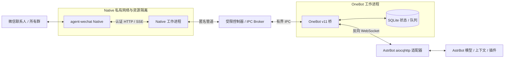

# MukPun-WeChat

**在 Linux 上连接微信与 AstrBot 的 OneBot v11 转发桥。**

本项目使用固定版本的 [agent-wechat Native](https://github.com/thisnick/agent-wechat/releases/tag/v1.0.0-beta.8) 接收、发送微信消息，将所有群聊和指定私聊转换为 OneBot v11 事件，通过反向 WebSocket 接入已有 AstrBot。

AI 模型、人格、上下文和插件由 AstrBot 管理。桥负责消息传输、身份映射、路由、图片交付、去重和发送回执，**不自行调用 LLM，也不保存模型 API Key**。

> 当前版本为经过实际账号验证的受限试运行实现，包含部署实例相关的目录布局和验证工具，尚不是一键安装、任意账号或无限期运行的通用发行版。公开仓库中的主机、用户和联系人信息均为示例值。

## 功能概览

| 功能 | 当前实现 |
| --- | --- |
| 实时消息接收 | 持续订阅 Native SSE，校验游标、事件摘要、消息方向和创建时间 |
| 群聊与私聊 | 自动接收所有群（包括新加入的群），私聊仍绑定指定联系人 |
| AI 回复 | 微信消息交给 AstrBot；兼容其已配置的模型和插件 |
| 群聊上下文 | 上报所有群普通文本，由 AstrBot 决定过滤、唤醒及回复 |
| 群聊唤醒 | 保留真实 `@机器人`，命令原文交给 AstrBot 处理 |
| 图片输入 | 将普通图片及关联问题交给 AstrBot，支持同会话引用、同成员群图关联 |
| 静态图片输出 | 支持单张 PNG、JPEG、静态 WebP；实际私聊、群聊及 AstrBot 插件发图已验证 |
| 长文本 | 校验 UTF-8 字节长度，按上限分段，依次发送并核对回执 |
| 防循环 | 真实自身 senderId 校验、方向过滤、消息 ID 去重、持久动作去重 |
| 队列与恢复 | SQLite 有界待转发队列、持久身份映射、游标保存和不确定结果保护 |
| 登录会话复用 | 完整资料快照及保存资料恢复路径，连接故障不自动退回扫码 |
| 状态与诊断 | CLI 状态、连接/队列/限额指标、无正文的图片拒绝原因及验收脚本 |
| WebUI / 在线配置 | 尚未实现，后续单独规划 |

桥不实现消息缓冲合并。需要合并连续消息、群聊分析或主动回复时，可由 AstrBot 的 `chat_plus` 等插件处理，避免两层重复合并。

## 架构



### 各层职责

| 层 | 主要模块 | 职责 |
| --- | --- | --- |
| 协议与消息转换 | `protocol.py`、`continuous.py`、`group_trigger.py` | OneBot 事件/API、参数校验、群/私聊路由、唤醒与文本分段 |
| 持久化 | `state.py`、`durable.py` | 稳定数字 ID、输入队列、游标、会话路由和已提交动作结果 |
| OneBot 传输 | `transport.py`、`forward_gateway.py` | 鉴权反向 WS、生命周期/心跳、IPC 请求关联及回执绑定 |
| Native 接入 | `forward_native_worker.py`、`forward_sse.py` | SSE 订阅、自动识别群路由、真实消息读取、自身消息过滤 |
| 图片输入 | `image_native.py`、`image_input.py` | 有界取图、图片引用和群内同成员问题关联 |
| 图片输出 | `image_output.py`、`image_send_native.py` | 格式/大小校验、分块组装、上传、发送作业及媒体投影核验 |
| 控制与隔离 | `run_forwarder.py`、`run_private_forwarder.py`、`media_egress.py` | 自有 systemd 服务、进程/资源检查、匿名 IPC、临时媒体网络许可 |
| 会话保存 | `session_runtime*.py`、`session_state_store.py` | 完整资料快照、会话恢复、禁止自动 fresh login |

### 入站：微信 → AstrBot

1. Native 工作进程订阅 SSE，根据真实事件读取消息。
2. 校验账号、群路由、消息方向、创建时间及游标摘要，拦截自身消息与历史回放。
3. 图片问题按同会话引用，或群内同一成员的关联窗口准备媒体。
4. 消息通过有界匿名 IPC 进入 OneBot 工作进程，先写入持久队列再确认游标。
5. 转换为 OneBot `message` 事件，附稳定的用户、群和消息数字 ID。
6. 通过反向 WebSocket 上报 AstrBot，模型与回复策略由 AstrBot 决定。

默认启用 `allGroupsEnabled`，所有群的普通文本直接上报，普通消息和 `/ai` 不会被伪造成 `@`，也不改写命令原文。群消息进入 AstrBot 不等于每条都必须调用模型，实际行为取决于 AstrBot 和插件配置。

### 出站：AstrBot → 微信

1. 校验 OneBot action、`echo`、目标 ID 和持久群路由；群回复策略由 AstrBot 管理，私聊保留当前会话回复窗口。
2. 校验整个消息链；当前支持文本，或单张静态图片及同会话引用。
3. 持久预留动作及幂等键。相同动作重复到达时返回缓存结果，不重新发送。
4. 文本按字节上限分段；图片按需要分块传输，完整校验后才调用 Native。
5. 发送 POST 只提交一次，后续读取已绑定作业状态，不因超时自动重发。
6. 成功须经过服务器接受回执及必要的消息投影核验；图片还校验源摘要、媒体上传读回和最终媒体摘要。

发送状态分为三类：

| 状态 | 处理 |
| --- | --- |
| 已确认接受 | 返回成功，保存结果及稳定消息 ID |
| 已确定未提交 / 提交前失败 | 明确返回失败并保留去重记录，继续其他文本转发 |
| 已进入提交阶段但结果不明 | 保留审计和待核对状态，不自动重发；必要时停止桥等待核对 |

创建本地发送作业成功不代表微信消息发送成功。特别是 SDK 在 `preparing`、`uploading`、`readback` 阶段的确定失败，不能与真正提交后的未知结果混为一谈。

## OneBot v11 支持范围

当前实现满足本项目与 AstrBot 联调所需的子集，**不是完整 OneBot v11 实现**。

| API / 事件 | 范围 |
| --- | --- |
| `send_msg`、`send_private_msg`、`send_group_msg` | 已识别的群和指定私聊；文本或受限单图；保持 `echo` 关联 |
| `get_login_info`、`get_status`、`get_version_info` | 当前桥身份、在线状态和版本信息 |
| `get_friend_list` | 指定测试联系人，不是完整微信好友列表 |
| `get_group_list`、`get_group_info` | 已观察到消息的群；新群首条消息自动建立稳定路由 |
| `get_group_member_info`、`get_stranger_info` | 已知身份的最小兼容资料，部分字段为展示占位，不是完整真实资料 |
| `can_send_image` | 反映静态单图输出开关，仍受格式和资源限制 |
| `can_send_record` | `false` |
| `message` | 群/私聊文本、受支持的图片问题、原生 @ 信息 |
| `meta_event` | 生命周期及心跳 |

常驻模式没有完整历史消息检索；早期单轮代码中的 `get_msg` 不能视为完整历史 API。群管理、成员全量列表、请求/通知事件、合并转发、语音/视频输出等尚未实现。不支持的 action 或消息段会明确返回失败，不伪造成功。

## 图片能力与限制

### 输入 AstrBot

- 支持普通图片消息及同会话图片引用。
- 群内可将同一成员 90 秒内的图片与唤醒问题关联，避免不同成员的图片串到一起。
- 单图数据上限 **128KiB**，优先使用合规缓存图，必要时取缩略图。
- 图片识别依赖 AstrBot 模型及插件的视觉配置，桥不生成图片描述。
- 微信原生 `type47` 表情包输入暂缓处理，不等同于普通图片输入。

### 输出到微信

- 支持单张 **PNG、JPEG、静态 WebP**，源文件最大 **8MiB**，超过后拒绝发送。
- 宽高分别不超过 **2048**，总像素不超过 **4 × 1024 × 1024**。
- OneBot 图片源使用 `base64://`，桥不读取 AstrBot 文件路径或下载任意图片 URL。
- WebSocket action 上限 **16MiB**，容纳 Base64 膨胀；内部 IPC 单帧仍为 **256KiB**，大图原始数据按 **64KiB** 分块并逐块确认。
- PNG 采用流式有界解压校验，验证 CRC、尺寸及扫描行，拒绝 APNG；WebP 拒绝动画标记。
- 桥不额外压缩图片。固定版本 Native SDK 的普通图片发送路径会准备 JPEG 变体，源文件字节不保证原样保留。
- GIF、动图、原生 sticker、多图和图文混合输出未支持。

固定 beta SDK 对部分素材仍可能在图片准备阶段返回失败。已知提交前失败现不会中断文本桥；未知提交结果仍执行待核对保护。

图片上传保留持久累计计数及容量门禁，原来的 16 次试运行门槛改为有限的百万次计数上限，不重置旧计数。新上传按源文件大小预留数据库和临时空间；相同摘要的已核验上传源在同一 Native 运行期内可复用。容量不足时拒绝新图片工作，文字仍可继续转发。

Native 安全停止后、恢复前，可以在离线快照副本上回收已确认发送完成的过期上传源；保留原快照，以及登录资料、消息、游标、回执和 SDK 媒体资料。不会为清理缓存自动重启登录，也不在线修改运行中的数据库。边界和验证见 [图片与存储容量说明](docs/image-8m-storage-128m.md)。

## 可靠性与资源隔离

### 防循环与重复发送

- 过滤出站事件和真实自身 senderId，而不是依赖机器人显示名。
- 依据原始消息 ID、摘要和持久游标去重。
- 使用 SQLite 保存会话路由、数字身份及发送动作结果，重启不更换已有映射。
- 发送动作关联目标会话、触发消息和 `echo`，使用稳定 Native 幂等键。
- 发送结果未知时不自动重试，不把旧问题静默重新交给模型。

### 有界状态

| 项目 | 当前限制 |
| --- | --- |
| 待转发队列 | 最多 32 条 / 2MiB |
| 单条文本 | 最多 32KiB；默认按 8192 UTF-8 字节分段 |
| 发送间隔 | 默认 5 秒，配置范围 5～60 秒 |
| 活跃回复窗口 | 群由 AstrBot 决定；指定私聊最近输入后 600 秒 |
| Native 运行期限 | 单次最多 7 天，桥受 Native 剩余租期约束 |
| Native 私有存储 | 128MiB；单文件保护 128MiB |

WebSocket 没有 AstrBot 业务处理确认，网络写入成功不能证明模型已完成处理。项目通过实际回执、持久状态和人工验收确认交付，不承诺严格的“绝不丢失、恰好一次”语义。

### 进程限制

| 进程 / 资源组 | 内存 max / high | CPU 配额 | 任务上限 |
| --- | --- | --- | --- |
| Native 父资源组 | 384MiB / 288MiB | 20% | 32 |
| Native SDK 及会话控制进程 | 256MiB / 192MiB | 受 Native 父组约束 | 16 |
| Native 转发工作进程 | 96MiB / 72MiB | 受 Native 父组约束 | 4 |
| OneBot 工作进程 | 128MiB / 96MiB | 10% | 8 |
| 控制器 | 64MiB / 48MiB | 5% | 16 |

工作进程使用非 root 身份及受限文件系统；凭据走匿名管道，微信资料留在项目外的私有目录。当前路线使用用户态网络与自有命名空间，不修改现有 Docker/FRP 服务、宿主防火墙、路由或加载宿主内核模块。

SSE 表示桥采用事件订阅；上游 SDK 内部仍可能检查本地事件存储，并不代表整个系统完全没有轮询，也不构成“账号无风控”的保证。

## 目录结构

```text
MukPun-WeChat/
├── wechat_bridge/                 # OneBot 协议、传输、状态、图片契约
├── scripts/                       # Native 适配、会话、隔离、控制和验证工具
├── tests/                         # 协议、队列、媒体、隔离及回归测试
├── docs/                          # 实施方案、阶段记录、功能与验收说明
├── acceptance/                    # 公开合成测试样本，不含真实会话或部署快照
├── config.forwarder.example.json  # 非敏感配置示例
├── requirements.txt               # 桥运行依赖
├── requirements-test.txt          # 模拟与开发依赖
└── requirements-test-lock.txt     # 测试环境版本快照
```

`scripts/` 同时保留早期 PoC 和一次性恢复工具。它们不是全部都应执行的安装步骤。特别是旧内核模块实验、fresh-login 探测及定向恢复脚本，应结合对应文档与前置条件理解，当前路线不使用宿主模块加载方案。

## 本地开发与模拟验证

以下流程只运行本地测试，不需要微信账号、LLM API Key 或服务器 root 权限。

```bash
git clone https://github.com/MukPun/MukPun-WeChat.git
cd MukPun-WeChat
python3.12 -m venv .venv
# Linux / macOS
source .venv/bin/activate
# Windows PowerShell 使用：.\.venv\Scripts\Activate.ps1
python -m pip install -r requirements-test.txt
python -m unittest discover -s tests -p "test_*.py"
python -m wechat_bridge.simulation
```

需要重现已记录的依赖组合时，可改用 `requirements-test-lock.txt`。POSIX、systemd 或网络命名空间相关用例在不支持的平台会跳过；跨平台模拟通过不能替代 Linux 隔离验证。

## 部署说明

### 环境与准备

- Linux、Python 3.12、systemd 及 cgroup v2；Native SDK 的架构/glibc 要求以固定版本说明为准。
- 已部署并能正常使用模型的 AstrBot。
- 固定版本 `agent-wechat v1.0.0-beta.8`，独立完成校验、隔离和账号初始化。
- SDK、用户态网络工具与项目依赖未作为二进制捆绑进本仓库。

先可运行只读检查：

```bash
bash scripts/doctor.sh
```

正式入口从 Git 工作副本运行：`scripts/run_forwarder.py`。私有配置为 `.runtime/forwarder.json`，固定 Native 二进制在 `.runtime/assets/`，受限工作进程使用 `.runtime/verification/` 代码视图和其中的依赖环境。`tools/sync_runtime.py --apply` 只同步源码视图，不覆盖依赖或会话。AstrBot 数据默认来自同级 `AstrBot/data/`。

根私有会话、审计和 OneBot 数据仍留在 `/var/lib/astrbot-wechat-session`、`/var/lib/astrbot-wechat-bridge`，不属于 Git 仓库。历史 PoC 文档中的 `poc-stage-01/` 是旧布局。克隆仓库不等于具备可用登录资料或安装完成；迁移必须先校验私有依赖和会话，再切换服务。见 [开发目录与运行资料](docs/checkout-runtime-layout.md)。

完整部署顺序与会话初始化前置条件见[实现方案](docs/implementation-plan.md)、[隔离验证](docs/poc-stage-01.md)、[会话生命周期](docs/session-lifecycle.md)。这些文档保留历史过程，当前功能范围以本 README 及后续修复记录为准。

### AstrBot 连接

在 AstrBot 中配置 **OneBot v11 / aiocqhttp 的反向 WebSocket 服务**。当前模板中的桥连接同机 `ws://127.0.0.1:6199/ws`，不开放新的公网 WebSocket 入口。

访问令牌须与现有 AstrBot 适配器一致。当前控制器从项目外已有 AstrBot 配置中读取，只经匿名管道交给 OneBot 工作进程，不写入公开配置样本。端口和路径仍是模板约束，调整时应同时核对适配器及桥端点校验。

### 转发配置

`config.forwarder.example.json` 只包含非敏感选项：

```json
{
  "schemaVersion": 1,
  "privateContact": "测试联系人",
  "groupName": "测试群",
  "groupPrefix": "/ai ",
  "groupWakeMode": "mention_or_prefix",
  "runtimeSeconds": 604200,
  "sendIntervalSeconds": 5,
  "segmentBytes": 8192,
  "imageInputEnabled": false,
  "groupContextEnabled": false,
  "imageOutputEnabled": false,
  "allGroupsEnabled": true
}
```

| 字段 | 作用 |
| --- | --- |
| `privateContact` / `groupName` | 私聊仍绑定联系人；`groupName` 仅用于旧的单群兼容模式 |
| `allGroupsEnabled` | 默认 `true`；所有群自动转发，群过滤、唤醒及回复交给 AstrBot；旧配置缺少字段时也默认开启 |
| `groupWakeMode` | 仅在关闭 `allGroupsEnabled` 的旧单群模式生效 |
| `groupContextEnabled` | 仅用于旧单群模式；全群模式自动上报普通消息 |
| `imageInputEnabled` | 普通图片输入及问题关联 |
| `imageOutputEnabled` | 开启受限单张静态图片输出 |
| `runtimeSeconds` | 有限运行期限，不是无限续租开关 |

真实配置留在 `.runtime/forwarder.json` 并设为 `0600`，不要提交 Git。功能开关更改后需按部署文档重启本项目桥；它不是热更新配置。

### 已完成部署后的操作

在完成前述部署与路径适配的实例中：

```bash
sudo python3 -I -B scripts/run_forwarder.py status
sudo python3 -I -B scripts/run_forwarder.py restart
sudo python3 -I -B scripts/run_forwarder.py stop
```

常规桥重启复用 Native 会话。资料或连接异常应先检查状态与备份，不自动 fresh login，不要求反复扫码。`reconcile_*`、`restore_*` 等工具针对特定审计状态，不能当作日常“强制恢复”命令。

## 验证状态

- 已实际验证群聊、私聊持续文本往返，中文、换行与 emoji 完整性及无重复。
- 已验证普通群文本上下文、原生 @ 与 `/ai ` 兼容。
- 已验证私聊/群聊图片输入交给 AstrBot，以及静态图片输出与实际插件交付。
- 最新已部署的 Linux 隔离核心回归 **226 项通过**。
- 实际图库样本的受限客户端验证保持 32MiB 内存上限，计入 cgroup 的峰值约 22.8MiB，未发生 OOM。
- 已修复大 base64 action 被 IPC 帧预算错误截断导致的 API 超时，以及 SDK 提交前失败误触发停桥的问题。

这些验证不代表任意微信账号、任意素材、完整 OneBot API 或长期稳定性全部通过。尚未完成无限期续租、完整七天运行、通用安装器、多群推广与 SDK 缓存安全回收验收。

## 凭据与发布边界

仓库只包含源码、测试、文档和合成样本，不包含：

- LLM API Key、OneBot 令牌、密码或 SSH 私钥。
- 真实 `.env`、`forwarder.json`、AstrBot 配置。
- 微信登录资料、二维码、profile、cookies、SDK 密钥或账号映射数据库。
- SQLite 运行库、会话快照、日志、虚拟环境、SDK 二进制和机器生成的部署副本。

`.gitignore` 是辅助措施，发布前仍须检查实际待提交文件。测试中出现的虚构 token、UUID、图片摘要和错误样本不是真实凭据。

## 文档与参考

- [开发文档：技术方案、架构与核心概念](docs/DEVELOPMENT.md)
- [AI 接手与开发约束](AGENTS.md)（[AGENT.MD 入口](AGENT.MD)）
- [功能路线与范围](docs/forwarding-roadmap.md)
- [持续文本转发](docs/plan1-text-forwarding.md)
- [防循环](docs/plan2-loop-protection.md)
- [群聊上下文](docs/group-context-forwarding.md)
- [图片输入](docs/plan3-image-input.md)
- [静态图片输出](docs/static-image-output.md)
- [图片兼容与失败分类修复](docs/static-image-compatibility-fix.md)
- [核心验收记录](docs/core-acceptance.md)

相关项目：[AstrBot](https://github.com/AstrBotDevs/AstrBot)、[agent-wechat](https://github.com/thisnick/agent-wechat)、[OneBot v11](https://github.com/botuniverse/onebot-11)。转发组织方式参考了 [Akasha-WeChat](https://github.com/alingalingling/Akasha-WeChat) 与 [NapCatQQ](https://github.com/NapNeko/NapCatQQ)，本项目微信接入仍使用 Linux Native 路线。
