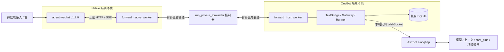
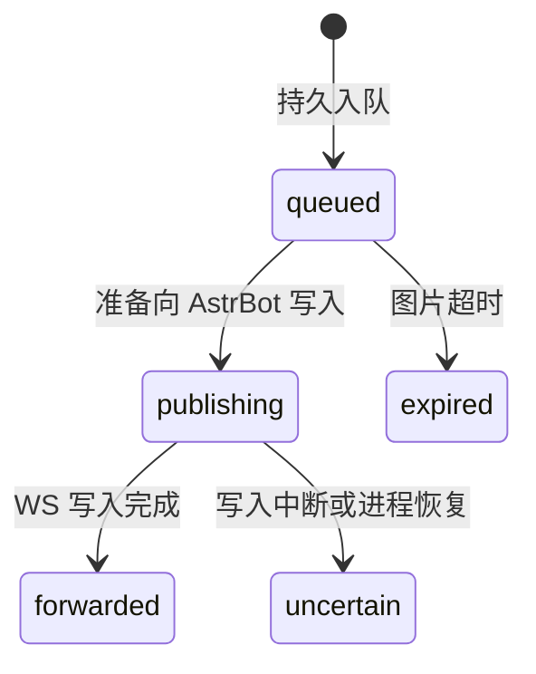

# MukPun-WeChat 开发文档

本文说明技术方案、架构、核心概念和继续开发的方法。整理日期：2026-10-28；以当前源码为基准，已包含全群路由、成员昵称/群名片及静态图片输出。本文不表示整理时重新检查过云服务器，也不包含生产连接资料。

AI 接手先读 [AGENTS.md](../AGENTS.md)，功能及使用概览见 [README](../README.md)。阶段文档保留过程和验收证据；与当前代码冲突时，应确认代码及实际部署版本，不能把历史限制直接当成当前行为。

## 1. 技术方案与职责划分

目标是在 Linux 上复用已有 AstrBot，为微信提供受控的 OneBot v11 通道。桥不运行独立模型、不管理人格、不判断群消息是否值得调用 AI。消息处理链路为：



| 技术 | 选择与原因 |
| --- | --- |
| 微信接入 | 源码固定 `agent-wechat v1.2.0`；线上切换及实际验证另见 [升级记录](native-1.2.0-upgrade.md)，不在桥内重新实现微信协议 |
| 桥语言 | Python 3.12；协议、状态和隔离控制可独立测试 |
| 入站传输 | Native SSE 推送；持久游标和事件摘要用于恢复校验 |
| 进程间通信 | 逐行 JSON 匿名管道；明确字段、大小、目标及请求回执绑定 |
| AstrBot 接入 | OneBot v11 Universal 反向 WebSocket；桥主动连接同机 AstrBot |
| 持久状态 | Python 标准库 SQLite，私有权限、有界容量和明确事务 |
| 运行隔离 | systemd / cgroup v2、非 root 工作进程、受限文件系统和用户态网络 |
| 外部依赖 | 运行依赖 `websockets==15.0.1`；模拟测试另使用 aiocqhttp、Quart、Hypercorn，版本见依赖文件 |

Akasha-WeChat 和 NapCatQQ 是组织转发、事件与协议边界的参考。本项目采用自己的 Linux Native、匿名 IPC 和回执链路，不是上述项目的直接部署方式。

## 2. 关键概念

| 概念 | 在本项目中的含义 |
| --- | --- |
| Native | 固定版本微信接入进程，持有微信会话和私有 API，提供消息、媒体和发送作业 |
| SSE | 服务端事件流；收到通知后按真实 ID 读取消息。不是业务成功确认，也不保证上游 SDK 内部绝对没有本地存储轮询 |
| 反向 WebSocket | 桥是客户端，AstrBot 提供 WS 服务端；Universal 通道同时传消息事件、API 请求和响应 |
| OneBot 事件 / action | 事件描述收到的消息；action 是 AstrBot 要桥执行的操作，例如 `send_group_msg` |
| `echo` | AstrBot 的请求关联值；必须原样带回响应，不能把它单独当成全局唯一消息 ID |
| 原始 ID / 数字 ID | 微信 ID 是真实身份和路由依据；OneBot 数字 ID 是持久映射，不能用昵称或临时 hash 替代 |
| 真实自身 senderId | 从已接受且投影核验的发送记录取得，用来过滤自身消息；与桥保留的 OneBot bot 身份区分 |
| 游标 / 锚点 | 游标表示事件位置；锚点是事件内容摘要，防止资料恢复后相同游标编号对应了别的内容 |
| 背压 / 有界队列 | 下游忙时控制读取与发送速度；达到容量应明确报错，不能默默丢消息。不是消息合并 |
| 幂等 | 已处理的同一动作返回保存结果，尽量避免网络故障造成重复提交；不等于任何故障下恰好一次 |
| `accepted` | 微信服务器接受且满足本项目核验；不等于对方已读，实际客户端交付仍需验收 |
| 投影 | SDK 将发送结果保存为可读取的本地消息，供目标、正文或媒体摘要核对 |
| `uncertain` | 可能已交付但无法证明的状态；必须保留证据，不能自动重发或重新调用模型 |
| 快照 / 租期 | 快照保存完整加密资料及数据库；租期限制单次运行时长。保存快照不保证信任永不过期 |

## 3. 模块与启动关系

### 正式运行入口

`scripts/run_forwarder.py` 读取版本化非敏感配置，并把已有控制器绑定到正式 `astrbot-wechat-forwarder.service`。控制器仍复用名为 `run_private_forwarder.py` 的模块；这个历史文件名不表示现行仅支持私聊。

控制器核验已有 Native 所有者、会话和资源边界，准备经过核对的代码副本，启动 Native 与 OneBot 工作进程，校验 ready 后允许转发，汇总状态与审计。OneBot 工作进程只持有连接 AstrBot 必需的 token；微信 Native 凭据不会交给 OneBot。

| 位置 | 责任及修改时的关注点 |
| --- | --- |
| `wechat_bridge/protocol.py` | 公共数据模型、JSON/action 校验、基础 API 和回执验证；还被早期单轮路径复用 |
| `wechat_bridge/continuous.py` | 正式群/私聊事件、完整消息链校验、分段、回复权限和持久动作幂等 |
| `wechat_bridge/transport.py` | 本机 WS、认证头、生命周期、15 秒业务心跳、重连及 action 解码 |
| `wechat_bridge/forward_gateway.py` | 持久入队、游标 ACK、请求 future、图片块 ACK 和回执绑定 |
| `wechat_bridge/forward_wire.py` | 生产 IPC 单帧上限、唯一 JSON 键及增量行解析 |
| `wechat_bridge/state.py` | 身份、动作结果和展示名称的 SQLite 表与私有权限 |
| `wechat_bridge/durable.py` | inbox、checkpoints、message_routes；重启后的 uncertain 处理 |
| `wechat_bridge/group_trigger.py` | 识别 `@chatroom` 路由、核验真实 @、旧单群准入规则 |
| `wechat_bridge/sender_names.py` | 精确 ID 的只读目录查询，有界成功/缺失缓存，名称清洗 |
| `scripts/forward_native_worker.py` | Native 消息和媒体读取、群路由、真实自身身份与命令执行 |
| `scripts/forward_sse.py` | 事件流边界解析、游标、锚点核对与 ACK 后续读 |
| `scripts/forward_host_worker.py` | 在 OneBot 隔离环境组装 State、Gateway、TextBridge 和 Runner |
| `scripts/run_private_forwarder.py` | 两端 IPC 中介、真实提交审计、图片预算和 cgroup 状态 |
| `scripts/session_runtime*.py` | Native 所有者、有限生命周期、状态与会话恢复 |
| `scripts/session_state_store.py` | 受限快照 current/previous、校验、私有副本恢复与原子提交 |
| `scripts/media_egress.py` | 受控媒体网络许可；不能扩展成任意 URL 下载代理 |

`wechat_bridge/gateway.py`、`ipc.py`、`scripts/bridge_*` 及 `poc-*` 文档保留单轮或早期验证路径。生产 IPC 是 `forward_wire.py`，不是早期 `ipc.py` 的 32KiB 上限。不要仅按同名类或文件注释判断实际运行路径。

### 源码、部署副本与状态

源码组织为 `wechat_bridge/` 和 `scripts/`，正式入口直接从 Git 工作副本运行。`project_paths.py` 派生 `.runtime` 私有配置、资产及 `verification` 视图；`tools/sync_runtime.py --apply` 按源码摘要更新视图并保留依赖。控制器另维护带入隔离环境的文件清单，新模块须核对打包、白名单及导入位置。旧 `poc-stage-01/` 仅保留回退及历史验证用途。详见 [目录布局](checkout-runtime-layout.md)。

公开模板中的 `/home/bridgeuser/astrbot-wechat`、`/home/bridgeuser/AstrBot` 是示例。当前脚本仍有实例布局约束，不是任意 clone 位置都能一键安装。

| 私有运行位置 | 内容 |
| --- | --- |
| `/var/lib/astrbot-wechat-session` | Native 保存资料、发送审计、验证绑定和预算；禁止上传 |
| `/run/astrbot-wechat-session` | 控制/状态文件及短期敏感资料；不是公开日志目录 |
| `/var/lib/astrbot-wechat-bridge/private-forward.sqlite` | 工作进程视角的 OneBot 身份、队列、游标和动作结果；实际宿主位置受 systemd 私有状态目录影响 |
| 实例的 `forwarder.json` | 实际联系人及非敏感功能配置；仍按私有配置管理，不提交 |

## 4. 入站链路：微信到 AstrBot

1. Native SSE 从已确认游标继续；恢复时对照锚点，不自动跳过缺失/冲突位置。
2. 按事件 ID 获取真实消息，核对 account、thread、direction、origin、创建时间、真实 senderId 与消息类型。不能用读取时间冒充消息创建时间。
3. 全群模式接受合法群 ID，首条消息建立路由；私聊只接受绑定联系人。出站/自身消息多层拦截。
4. 按需取普通图片，并解析展示名称；名称读取失败保留正文，图片失败按明确策略计数，不伪造图片内容。
5. 控制器和 Gateway 再核对来源与负载。`Spool.admit()` 持久写入成功后保存 checkpoint 并 ACK，SSE 才继续。
6. `TextBridge.ingest()` 建立稳定数字 ID、消息到会话绑定及 sender 信息，将队列标为 `publishing`。
7. `Runner` 发送 OneBot 事件；网络写入完成后标为 `forwarded` 并删除队列正文。中断则记为 `uncertain`，不静默重新交给模型。

### 全群、唤醒与模型调用

`allGroupsEnabled=true` 为正式默认，包括旧配置省略该字段的情况。所有群的普通文本逐条上报；开启 `imageInputEnabled` 后，受支持普通图片也直接上报。`get_group_list` 返回已观察并映射的群，新加入但尚未发消息的群未必在列表中。新增群的显示名可能暂时为“微信群+数字 ID”，不影响稳定路由。

全群模式中，只有可信 `msgsource.atuserlist` 确认 @ 机器人才附加 OneBot `at` 段；普通文本和 `/ai` 不伪造 @，命令正文原样保留。`/ai` 的实际响应取决于 AstrBot 现有指令/唤醒设置。旧单群模式仍可按 `prefix`、`mention`、`mention_or_prefix` 准入，并可开启普通文本上下文上报；这两种模式不要混写。

消息进入 AstrBot 不等于每条都调用 LLM。上下文缓存、概率主动回复、图片处理范围、合并和模型选择由 AstrBot 及插件管理。排查时不得擅自关闭或改写用户已有插件策略。

### 群成员名称

按真实群和用户 ID 精确读取本地联系人/成员目录，将名称放入 `sender.nickname`、`sender.card`，不拼入正文。单次预算 0.8 秒；成功缓存 300 秒、缺失 30 秒，最多 1024 项，名称最多 256 UTF-8 字节。

名称不参与源消息去重摘要，避免改名使旧消息重投。资料缺失只使用占位名，不能猜同名用户；逐消息解析只做 GET，不自动全量同步。定向 `members/refresh` 是另一个有副作用的资料更新操作，不是普通只读查询。详见[成员名称记录](group-member-names.md)。

## 5. 持久状态与防循环

| 表 | 用途与边界 |
| --- | --- |
| `identities` | `(kind, raw)` 到数字 ID；bot/group/user/incoming/outgoing，最多 8192 项 |
| `submissions` | 动作键、请求摘要、Native 幂等键和结果；最多 4096 项，无结果的预留视为 unknown |
| `member_names` | 群+用户展示资料，最多 8192 项；不参与身份授权 |
| `inbox` | 有界待转发负载及状态，最多 32 条/2MiB；完成后删除正文，保留有限去重元数据 |
| `checkpoints` | Native generation 的游标/锚点、OneBot namespace、会话触发消息等 |
| `message_routes` | OneBot 消息 ID 到真实会话的有限绑定，用于同会话引用校验 |



防循环同时依靠真实自身 senderId、方向检查、源 ID/摘要、持久游标和出站动作幂等。不能用“相同文本”“相同昵称”或任意时间窗代替身份校验；用户重复发送同一句话仍是不同消息。

WS 不提供 AstrBot 已处理的业务确认。因此 `forwarded` 仅证明本次网络交接完成，不证明模型已回答；对无法确认的交接不自动回放，优先防止重复调用或重复外发。这是明确的可靠性取舍，不是严格 exactly-once 保证。

## 6. 出站链路：AstrBot 到微信

1. 解码 action，校验 `self_id`、`echo`、目标数字 ID 和允许参数。全群回复仅投到已经有持久映射的群；私聊只投指定联系人且保留最近输入后 600 秒回复窗口。
2. 校验完整消息链及引用归属。当前是文本，或一张受支持图片及可选同会话引用；不支持内容不能悄悄丢弃后报告成功。
3. 按 namespace、目标、触发消息和 `echo` 生成持久动作键；请求摘要校验冲突。无 `echo` 请求会生成随机关联值，不能承诺跨请求去重。
4. 已有动作返回缓存结果；新动作先预留再发送。文本按 UTF-8 字节分段，保留正文、换行及 emoji，受全局发送锁和间隔约束。
5. 通过 IPC 交给控制器与 Native，绑定 requestId、account、destination、幂等键及图片源摘要。提交只发生一次，随后仅查询该作业状态。
6. 只有真实接受回执及必要消息投影验证通过才返回 OneBot 成功。分段部分成功、超时或进入提交阶段后无法确认时，保留审计，不重发整条消息。

| 结果 | 后续行为 |
| --- | --- |
| 校验拒绝 / 确定未提交 | 返回明确失败；已识别的不支持图片或提交前失败不应中断其余文本 |
| 已确认微信接受 | 返回成功，保存消息 ID 和结果 |
| 可能已提交但结果未知 | 返回/记录 unknown；保护停止或阻止恢复，等待核对，不能删审计绕过 |

常见桥返回值：`1400 invalid_request/unsupported_message_segment`、`1403` 路由/回复权限拒绝、`1408 outcome_unknown`、`1500 state_unavailable`、`1501 action_not_supported`。状态码说明的是桥的处理结果，不能统一解释成微信服务器风控。

图片本地作业创建成功不等于已发往微信。当前版本只有在 SDK 终态、阶段、server/native receipt 等条件证明为提交前失败时才认定“未提交”。不能仅凭看到某个阶段字符串或报错就重发。详见[兼容修复](static-image-compatibility-fix.md)。

## 7. 图片输入与输出

### 输入：微信普通图片交给 AstrBot

`scripts/image_native.py` 受限读取媒体，`image_input.py` 校验 MIME、尺寸、字节数、base64 和 SHA256，再转换为 OneBot `image` 段。优先合规缓存，必要时取缩略图；单图最多 128KiB，边长最多 2048，输入总像素最多 4×1024×1024。

支持同会话引用；群内关联按同一群、同一成员及 90 秒窗口，防止把甲的图片配给乙的问题。全群模式还可直接上报普通图片。实际视觉能力由 AstrBot 的模型和插件决定；插件 `at_only` 等范围可能使图片没进入最终模型历史，应分别核对 Native 类型、桥交付和 AstrBot 原始事件。

原生 `type=47` sticker 仍跳过，不以“静态”或“看起来像图片”判定其已支持。不要恢复探测或增加占位模型调用。普通图片与原生 sticker、输入与输出是不同能力。

### 输出：AstrBot 静态图片发回微信

- 接受 `base64://`，不读 AstrBot 文件路径、不抓任意 URL。兼容固定范围的 AstrBot 图片段可选字段，仍严格校验结构。
- 支持单张 PNG、JPEG、静态 WebP；最多 8MiB，超过拒绝，边长最多 2048，总像素最多 4×1024×1024。
- WS action 预算 16MiB，生产 IPC 单帧 256KiB；图片大于 128KiB 时用 64KiB 原始块逐块 ACK，完整组装校验后提交。
- 上传包含准备、上传、读回、提交和投影核验；SDK 可能重采样成 JPEG，不保证源文件字节不变。
- 拒绝 GIF/APNG/动画 WebP、多图、图文混合及原生 sticker 输出；不能把源图不支持统一当作网络超时。
- 持久上传计数保留旧值，有限计数上限为百万次；失败预留也计入。实际准入检查数据库、存储和内存余量，不能清空预算绕过容量门禁。新上传按 `max(1MiB, 2×源大小+512KiB)` 预留增长，并保留 16MiB 存储及 64MiB 父组内存余量。

`image_source_cache.py` 按已核验源摘要复用同一 Native 运行期上传，最多 64 项、24 小时；切换 Native 运行期自动失效。`media_cache_maintenance.py` 仅在 Native 停止后处理离线快照副本，回收已确认完成发送的过期上传源，保留全部其他表和资料文件。新增空闲维护 timer，在 500MiB 缓存预算或安全余量门槛触发时，备份并短暂停启 Native，回收已完成图片和语音上传源；仍不能当作完整 SDK 媒体资料生命周期管理。详见 [容量说明](image-8m-storage-128m.md)。部分素材仍可能在上游准备阶段失败；已有实际交付证据不应重复触发。

## 8. 配置与协议边界

正式配置 `schemaVersion=1`，字段集合封闭，拒绝重复键、未知字段和非法常量；配置原始字节最多 4096。完整样例见 [config.forwarder.example.json](../config.forwarder.example.json)，其中无任何认证材料。

| 配置 | 含义 |
| --- | --- |
| `privateContact` | 精确绑定的私聊联系人显示名；后续使用已验证原始 ID 投递 |
| `allGroupsEnabled` | 默认 true；省略时也开启。若改为 false，恢复旧单群模式 |
| `groupName` | 旧单群目录/验证；不是全群模式白名单 |
| `groupPrefix` / `groupWakeMode` | 旧模式唤醒，前缀固定 `/ai `；全群正文不因此改写 |
| `groupContextEnabled` | 旧单群普通文本准入；全群模式已接受普通消息 |
| `imageInputEnabled` / `imageOutputEnabled` | 媒体能力开关，样例默认 false，不代表线上当前开关 |
| `runtimeSeconds` | 600～604200 秒；Native 单次最长 604800 秒，桥还受剩余租期约束 |
| `sendIntervalSeconds` | 5～60 秒，默认 5 秒 |
| `segmentBytes` | 1024～8192 UTF-8 字节，默认 8192 |

更改配置不是热更新；实例文件建议 `0600`。当前控制器从项目外既有 AstrBot 配置获取 OneBot 令牌，通过匿名管道传递，桥连 `ws://127.0.0.1:6199/ws`；端点契约禁止任意远端 URL。修改端口需核对两端及校验逻辑，不能在公开配置里加密码。

OneBot 支持 `send_msg/send_private_msg/send_group_msg`、基本登录/状态/版本、已观察群及成员展示信息查询、`can_send_image`、消息事件和心跳/生命周期。好友查询只有配置联系人；没有完整成员目录、历史检索、群管理、请求/通知、语音视频或合并转发。早期 `get_msg` 分支不代表常驻历史 API，协议字符串 `v11` 不代表所有 API 都实现。

## 9. 运行保护与恢复原则

| 资源 | 现有边界 |
| --- | --- |
| Native 父资源组 | max/high 3072/2816MiB、20% CPU、32 tasks |
| Native SDK 及会话控制进程 | max/high 2560/2304MiB，共享 Native 父组限额 |
| Native 转发工作进程 | max/high 96/72MiB、4 tasks，共享 Native 父组限额 |
| OneBot 工作进程 | max/high 128/96MiB、10% CPU、8 tasks |
| 控制器 | max/high 64/48MiB、5% CPU、16 tasks |
| Native 私有 tmpfs | 缓存预算 500MiB；临时卷总计 2GiB；单文件保护 768MiB |
| 文本 / 队列 | 文本 32KiB；输入队列 32 条/2MiB |

这里只描述源码限制，排查线上必须读取实际 cgroup 和部署版本。内存 high/max、tmpfs、数据库文件上限和媒体预算保护不同资源，不能相互替代。

完整会话包括 registry、加密密钥、各账号数据库和 managed profile；只保存一个 cookie 或零散复制主 DB 不足以恢复。停止应保留最终一致快照，恢复在私有副本内处理必要 SQLite rollback，再只读完整性检查并拦截待发/未知 outbox。不能删除 journal 当作修复，也不能改写唯一原始快照。

常规桥重启保留 Native 会话；Native 会话恢复禁止自动 fresh login。断网、5xx、DNS、资料解密或资源错误先诊断，不能直接要求扫码。当前没有无限期运行保证，不能在没有设计和验收的情况下自动续租。

必须保护已有 Docker、AstrBot 和 FRP，不改宿主模块、防火墙、路由或现有映射。只操作本项目精确 unit/PID/命名空间，保留前后基线。历史内核模块脚本和定向恢复工具不是通用安装/运维命令。

## 10. 本地开发与验证

```bash
python3.12 -m venv .venv
# Linux / macOS
source .venv/bin/activate
# Windows PowerShell：.\.venv\Scripts\Activate.ps1
python -m pip install -r requirements-test.txt
python -m unittest discover -s tests -p "test_*.py" -q
python -m wechat_bridge.simulation
```

需要复现依赖组合时使用 `requirements-test-lock.txt`。本地模拟使用合成数据与本机监听，不需要微信或 LLM 凭据；涉及回环 socket 的用例仍需环境允许本机网络。

| 改动 | 优先测试文件（位于 `tests/`） |
| --- | --- |
| OneBot 参数、JSON、WS | `test_onebot_bridge.py`、`test_onebot_action_transport.py`、`test_onebot_simulation.py` |
| 持久队列、连续回复、IPC | `test_onebot_continuous.py`、`test_onebot_continuous_wire.py`、`test_onebot_native_forward.py` |
| 全群、唤醒、上下文 | `test_onebot_all_groups.py`、`test_onebot_mentions.py`、`test_onebot_context.py`、`test_onebot_routing.py` |
| 自身过滤、幂等 | `test_onebot_loop_guard.py`、`test_onebot_continuous.py` |
| 昵称与名片 | `test_onebot_sender_names.py`，同时覆盖同源事件改名不重投 |
| 图片输入 | `test_onebot_images.py`、`test_onebot_native_forward.py` |
| 图片输出、预算与失败阶段 | `test_onebot_image_output.py`、`test_onebot_image_output_native.py`、`test_onebot_image_output_budget.py`、`test_onebot_output_policy.py` |
| 会话恢复与快照 | `test_session_state_store.py`、`test_session_resume_protocol.py`、`test_session_runtime*.py`、`test_onebot_boot_restore.py` |
| 媒体网络 | `test_onebot_media_egress.py` 及对应隔离验证 |

可只选相关测试，例如 `python -m unittest discover -s tests -p "test_onebot_all_groups.py" -q`。纯文档修改检查链接、描述与脱敏即可，不需重复整套回归或真实模型测试。

历史最新记录为本地 681 项（27 项平台跳过）、Linux 受限 OneBot 240 项通过，详见[成员名称与恢复记录](group-member-names.md)。这是已有记录，不是本次文档任务重新执行的结果。Windows 跳过的权限、POSIX 管道和 systemd 用例需要 Linux 对应验证，合成测试也不能代替真实交付验收。

## 11. 继续开发的流程

1. 在本地确认当前分支、工作区和任务边界；查阅对应源代码与专题，不从旧聊天推断线上健康。
2. 明确改动属于协议、控制器、Native 适配还是 AstrBot 策略；不在桥内增加模型密钥或重复消息合并。
3. 本地实现及适当回归；跨 IPC 增加字段或模块时同步检查字段白名单、两个工作进程、控制器和打包清单。
4. 若任务涉及部署，先核对目标实例、现有服务状态、剩余租期、队列、未完成发送、资源和备份；部署前后比较本项目与 Docker/FRP/网络基线。
5. 仅更新本项目，优先只重启桥。失败时保留审计，按实际状态判断是否可以恢复，不运行不适用的 `restore_*` 或 `reconcile_*`。
6. 尽量用已有消息与只读证据验收。额外真实发送须明确目标、内容/类型、数量和是否消耗模型额度；旧一次性授权不可复用，不确定结果不重发。
7. 更新文档与验证记录，明确代码已改、是否部署、是否实际交付；不扩大既有验收结论。

在完成既有实例适配后，可用 `sudo python3 -I -B /home/bridgeuser/astrbot-wechat/poc-stage-01/run_forwarder.py status` 查看状态。它只是示例路径；不要把 `restart`、`promote`、`install` 或旧恢复脚本当作了解项目的第一步。

## 12. 常见排查路径

| 现象 | 优先核对 |
| --- | --- |
| 完全不回复 | 桥 ready、SSE、astrbot_connected、队列和 self_identity_verified；再看 AstrBot 唤醒/插件/模型，不能先扫码 |
| 普通群消息没触发 AI | 先确认事件是否到 AstrBot；收到事件与是否调用模型是两回事 |
| 群图片没进模型历史 | Native 是否 type3/type47、图片开关和计数、AstrBot 原始消息段、插件图片处理范围 |
| 昵称是占位名 | 当前发言人的精确 ID 是否有本地目录资料；不要用模糊同名搜索或全量刷新代替诊断 |
| `1400 unsupported_message_segment` | 图片开关、base64 源、单图链结构、格式/尺寸/字节数及无正文拒绝指标 |
| API 超时 | 分别检查 WS action 4MiB、IPC 帧 256KiB、分块 ACK、作业阶段和回执绑定；不能只统一加大 timeout |
| 桥停止且 requires_review | 保留 queue/submission/图片审计，判明提交前失败还是提交后 unknown；不能清空数据库强行启动 |
| Native 恢复失败 | 完整保存资料、SQLite journal/outbox、密钥、路径、容量与租期；不自动 fresh login |

日志和诊断输出仅保留必要计数、错误码和经审查的元数据。不要把原消息、base64 图像、完整真实 ID、令牌或配置原文直接粘贴进公开 issue。

## 13. 待办、明确不做与发布

已验收：指定私聊/群连续文本、上下文、原生 @、防循环、普通图输入、静态图输出及实际插件交付。后续扩展已包含全群自动路由及真实群成员展示名称，但多群长期运行、完整七天及异常恢复仍需持续验证。

后续由用户选定范围再推进：长期生命周期、媒体缓存安全回收与预算生命周期、通用安装与路径配置、更多 OneBot 能力、WebUI 及在线配置设计。WebUI 不能直接暴露 token、profile 或任意 shell；具体方案尚未确定。

缓冲合并由 AstrBot `chat_plus` 负责；原生 sticker 输入暂缓，不再作为核心未完成项反复测试。语音、视频、完整群管理等不是已实现能力。

提交只允许源码、测试、文档与已审合成样本。禁止任何 API Key、密码、SSH 密钥、OneBot/Native token、真实配置、二维码、会话/profile、运行数据库、快照和真实聊天媒体；不得从实例目录整体复制并提交。

```bash
git diff --check
python tools/audit_publication.py .
git diff --stat
git diff --cached --stat
```

审计工具只输出规则/文件/行号，不输出候选密钥值；它是辅助检查，仍须审查实际暂存差异。用 `.gitignore` 排除 `.publish/`、运行资料、虚拟环境和生成发布副本，不能将忽略规则当作“历史提交一定无敏感数据”的证明。

相关专题：[文本转发](plan1-text-forwarding.md)、[防循环](plan2-loop-protection.md)、[群上下文](group-context-forwarding.md)、[图片输入](plan3-image-input.md)、[静态图片输出](static-image-output.md)、[会话生命周期](session-lifecycle.md)。
