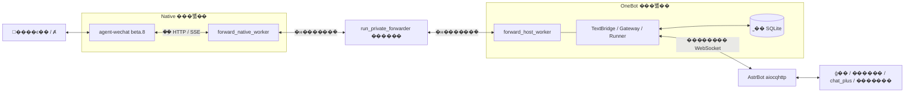
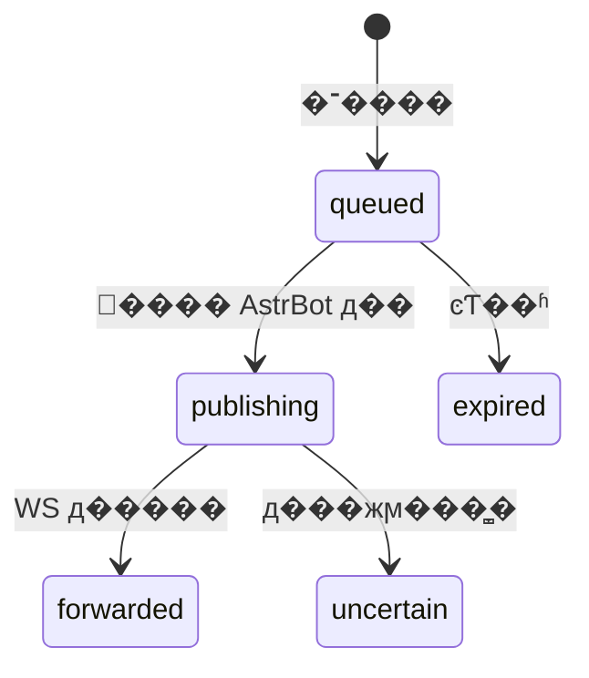

# MukPun-WeChat �����ĵ�

����˵�������������ܹ������ĸ���ͼ��������ķ������������ڣ�2026-10-28���Ե�ǰԴ��Ϊ��׼���Ѱ���ȫȺ·�ɡ���Ա�dz�/Ⱥ��Ƭ����̬ͼƬ��������IJ���ʾ����ʱ���¼����Ʒ�������Ҳ�����������������ϡ�

AI �����ȶ� [AGENTS.md](../AGENTS.md)�����ܼ�ʹ�ø����� [README](../README.md)���׶��ĵ��������̺�����֤�ݣ��뵱ǰ�����ͻʱ��Ӧȷ�ϴ��뼰ʵ�ʲ���汾�����ܰ���ʷ����ֱ�ӵ��ɵ�ǰ��Ϊ��

## 1. ����������ְ�𻮷�

Ŀ������ Linux �ϸ������� AstrBot��Ϊ΢���ṩ�ܿص� OneBot v11 ͨ�����Ų����ж���ģ�͡��������˸񡢲��ж�Ⱥ��Ϣ�Ƿ�ֵ�õ��� AI����Ϣ������·Ϊ��



| ���� | ѡ����ԭ�� |
| --- | --- |
| ΢�Ž��� | �̶� `agent-wechat v1.0.0-beta.8`����������֤�� Linux Native ������������������ʵ��΢��Э�� |
| ������ | Python 3.12��Э�顢״̬�͸�����ƿɶ������� |
| ��վ���� | Native SSE ���ͣ��־��α���¼�ժҪ���ڻָ�У�� |
| ���̼�ͨ�� | ���� JSON �����ܵ�����ȷ�ֶΡ���С��Ŀ�꼰�����ִ�� |
| AstrBot ���� | OneBot v11 Universal ���� WebSocket������������ͬ�� AstrBot |
| �־�״̬ | Python ��׼�� SQLite��˽��Ȩ�ޡ��н���������ȷ���� |
| ���и��� | systemd / cgroup v2���� root �������̡������ļ�ϵͳ���û�̬���� |
| �ⲿ���� | �������� `websockets==15.0.1`��ģ�������ʹ�� aiocqhttp��Quart��Hypercorn���汾�������ļ� |

Akasha-WeChat �� NapCatQQ ����֯ת�����¼���Э��߽�IJο�������Ŀ�����Լ��� Linux Native������ IPC �ͻ�ִ��·������������Ŀ��ֱ�Ӳ���ʽ��

## 2. �ؼ�����

| ���� | �ڱ���Ŀ�еĺ��� |
| --- | --- |
| Native | �̶��汾΢�Ž�����̣�����΢�ŻỰ��˽�� API���ṩ��Ϣ��ý��ͷ�����ҵ |
| SSE | ������¼������յ�֪ͨ����ʵ ID ��ȡ��Ϣ������ҵ��ɹ�ȷ�ϣ�Ҳ����֤���� SDK �ڲ�����û�б��ش洢��ѯ |
| ���� WebSocket | ���ǿͻ��ˣ�AstrBot �ṩ WS ����ˣ�Universal ͨ��ͬʱ����Ϣ�¼���API �������Ӧ |
| OneBot �¼� / action | �¼������յ�����Ϣ��action �� AstrBot Ҫ��ִ�еIJ��������� `send_group_msg` |
| `echo` | AstrBot ���������ֵ������ԭ��������Ӧ�����ܰ�����������ȫ��Ψһ��Ϣ ID |
| ԭʼ ID / ���� ID | ΢�� ID ����ʵ���ݺ�·�����ݣ�OneBot ���� ID �dz־�ӳ�䣬�������dzƻ���ʱ hash ��� |
| ��ʵ���� senderId | ���ѽ�����ͶӰ����ķ��ͼ�¼ȡ�ã���������������Ϣ�����ű����� OneBot bot �������� |
| �α� / ê�� | �α��ʾ�¼�λ�ã�ê�����¼�����ժҪ����ֹ���ϻָ�����ͬ�α��Ŷ�Ӧ�˱������ |
| ��ѹ / �н���� | ����æʱ���ƶ�ȡ�뷢���ٶȣ��ﵽ����Ӧ��ȷ����������ĬĬ����Ϣ��������Ϣ�ϲ� |
| �ݵ� | �Ѵ�����ͬһ�������ر��������������������������ظ��ύ���������κι�����ǡ��һ�� |
| `accepted` | ΢�ŷ��������������㱾��Ŀ���飻�����ڶԷ��Ѷ���ʵ�ʿͻ��˽����������� |
| ͶӰ | SDK �����ͽ������Ϊ�ɶ�ȡ�ı�����Ϣ����Ŀ�ꡢ���Ļ�ý��ժҪ�˶� |
| `uncertain` | �����ѽ������޷�֤����״̬�����뱣��֤�ݣ������Զ��ط������µ���ģ�� |
| ���� / ���� | ���ձ��������������ϼ����ݿ⣻�������Ƶ�������ʱ����������ղ���֤������������ |

## 3. ģ����������ϵ

### ��ʽ�������

`scripts/run_forwarder.py` ��ȡ�汾�����������ã��������п������󶨵���ʽ `astrbot-wechat-forwarder.service`���������Ը�����Ϊ `run_private_forwarder.py` ��ģ�飻�����ʷ�ļ�������ʾ���н�֧��˽�ġ�

�������������� Native �����ߡ��Ự����Դ�߽磬׼�������˶ԵĴ��븱�������� Native �� OneBot �������̣�У�� ready ������ת��������״̬����ơ�OneBot ��������ֻ�������� AstrBot ����� token��΢�� Native ƾ�ݲ��ύ�� OneBot��

| λ�� | ���μ��޸�ʱ�Ĺ�ע�� |
| --- | --- |
| `wechat_bridge/protocol.py` | ��������ģ�͡�JSON/action У�顢���� API �ͻ�ִ��֤���������ڵ���·������ |
| `wechat_bridge/continuous.py` | ��ʽȺ/˽���¼���������Ϣ��У�顢�ֶΡ��ظ�Ȩ�޺ͳ־ö����ݵ� |
| `wechat_bridge/transport.py` | ���� WS����֤ͷ���������ڡ�15 ��ҵ�������������� action ���� |
| `wechat_bridge/forward_gateway.py` | �־���ӡ��α� ACK������ future��ͼƬ�� ACK �ͻ�ִ�� |
| `wechat_bridge/forward_wire.py` | ���� IPC ��֡���ޡ�Ψһ JSON ���������н��� |
| `wechat_bridge/state.py` | ���ݡ����������չʾ���Ƶ� SQLite ����˽��Ȩ�� |
| `wechat_bridge/durable.py` | inbox��checkpoints��message_routes��������� uncertain ���� |
| `wechat_bridge/group_trigger.py` | ʶ�� `@chatroom` ·�ɡ�������ʵ @���ɵ�Ⱥ׼����� |
| `wechat_bridge/sender_names.py` | ��ȷ ID ��ֻ��Ŀ¼��ѯ���н�ɹ�/ȱʧ���棬������ϴ |
| `scripts/forward_native_worker.py` | Native ��Ϣ��ý���ȡ��Ⱥ·�ɡ���ʵ��������������ִ�� |
| `scripts/forward_sse.py` | �¼����߽�������αꡢê��˶��� ACK ������ |
| `scripts/forward_host_worker.py` | �� OneBot ���뻷����װ State��Gateway��TextBridge �� Runner |
| `scripts/run_private_forwarder.py` | ���� IPC �н顢��ʵ�ύ��ơ�ͼƬԤ��� cgroup ״̬ |
| `scripts/session_runtime*.py` | Native �����ߡ������������ڡ�״̬��Ự�ָ� |
| `scripts/session_state_store.py` | ���޿��� current/previous��У�顢˽�и����ָ���ԭ���ύ |
| `scripts/media_egress.py` | �ܿ�ý���������ɣ�������չ������ URL ���ش��� |

`wechat_bridge/gateway.py`��`ipc.py`��`scripts/bridge_*` �� `poc-*` �ĵ��������ֻ�������֤·�������� IPC �� `forward_wire.py`���������� `ipc.py` �� 32KiB ���ޡ���Ҫ����ͬ������ļ�ע���ж�ʵ������·����

### Դ�롢���𸱱���״̬

Դ����֯Ϊ `wechat_bridge/` �� `scripts/`�����в�����ʹ�� `poc-stage-01/`��`verification/` �͸�������е� `/opt/bridge` �Ȳ��֡���������ά����������뻷�����ļ��嵥���½�ģ���ֻ��Դ����ܲ���������ͬ���˶Դ�����ļ��������͵���λ�á�

����ģ���е� `/home/bridgeuser/astrbot-wechat`��`/home/bridgeuser/AstrBot` ��ʾ������ǰ�ű�����ʵ������Լ������������ clone λ�ö���һ����װ��

| ˽������λ�� | ���� |
| --- | --- |
| `/var/lib/astrbot-wechat-session` | Native �������ϡ�������ơ���֤�󶨺�Ԥ�㣻��ֹ�ϴ� |
| `/run/astrbot-wechat-session` | ����/״̬�ļ��������������ϣ����ǹ�����־Ŀ¼ |
| `/var/lib/astrbot-wechat-bridge/private-forward.sqlite` | ���������ӽǵ� OneBot ���ݡ����С��α�Ͷ��������ʵ������λ���� systemd ˽��״̬Ŀ¼Ӱ�� |
| ʵ���� `forwarder.json` | ʵ����ϵ�˼������й������ã��԰�˽�����ù��������ύ |

## 4. ��վ��·��΢�ŵ� AstrBot

1. Native SSE ����ȷ���α�������ָ�ʱ����ê�㣬���Զ�����ȱʧ/��ͻλ�á�
2. ���¼� ID ��ȡ��ʵ��Ϣ���˶� account��thread��direction��origin������ʱ�䡢��ʵ senderId ����Ϣ���͡������ö�ȡʱ��ð����Ϣ����ʱ�䡣
3. ȫȺģʽ���ܺϷ�Ⱥ ID��������Ϣ����·�ɣ�˽��ֻ���ܰ���ϵ�ˡ���վ/������Ϣ������ء�
4. ����ȡ��ͨͼƬ��������չʾ���ƣ����ƶ�ȡʧ�ܱ������ģ�ͼƬʧ�ܰ���ȷ���Լ�������α��ͼƬ���ݡ�
5. �������� Gateway �ٺ˶���Դ�븺�ء�`Spool.admit()` �־�д��ɹ��󱣴� checkpoint �� ACK��SSE �ż�����
6. `TextBridge.ingest()` �����ȶ����� ID����Ϣ���Ự�󶨼� sender ��Ϣ�������б�Ϊ `publishing`��
7. `Runner` ���� OneBot �¼�������д����ɺ��Ϊ `forwarded` ��ɾ���������ġ��ж����Ϊ `uncertain`������Ĭ���½���ģ�͡�

### ȫȺ��������ģ�͵���

`allGroupsEnabled=true` Ϊ��ʽĬ�ϣ�����������ʡ�Ը��ֶε����������Ⱥ����ͨ�ı������ϱ������� `imageInputEnabled` ����֧����ͨͼƬҲֱ���ϱ���`get_group_list` �����ѹ۲첢ӳ���Ⱥ���¼��뵫��δ����Ϣ��Ⱥδ�����б��С�����Ⱥ����ʾ��������ʱΪ��΢��Ⱥ+���� ID������Ӱ���ȶ�·�ɡ�

ȫȺģʽ�У�ֻ�п��� `msgsource.atuserlist` ȷ�� @ �����˲Ÿ��� OneBot `at` �Σ���ͨ�ı��� `/ai` ��α�� @����������ԭ��������`/ai` ��ʵ����Ӧȡ���� AstrBot ����ָ��/�������á��ɵ�Ⱥģʽ�Կɰ� `prefix`��`mention`��`mention_or_prefix` ׼�룬���ɿ�����ͨ�ı��������ϱ���������ģʽ��Ҫ��д��

��Ϣ���� AstrBot ������ÿ�������� LLM�������Ļ��桢���������ظ���ͼƬ������Χ���ϲ���ģ��ѡ���� AstrBot ������������Ų�ʱ�������Թرջ��д�û����в�����ԡ�

### Ⱥ��Ա����

����ʵȺ���û� ID ��ȷ��ȡ������ϵ��/��ԱĿ¼�������Ʒ��� `sender.nickname`��`sender.card`����ƴ�����ġ�����Ԥ�� 0.8 �룻�ɹ����� 300 �롢ȱʧ 30 �룬��� 1024 �������� 256 UTF-8 �ֽڡ�

���Ʋ�����Դ��Ϣȥ��ժҪ���������ʹ����Ϣ��Ͷ������ȱʧֻʹ��ռλ�������ܲ�ͬ���û�������Ϣ����ֻ�� GET�����Զ�ȫ��ͬ�������� `members/refresh` ����һ���и����õ����ϸ��²�����������ֻͨ����ѯ�����[��Ա���Ƽ�¼](group-member-names.md)��

## 5. �־�״̬���ѭ��

| �� | ��;��߽� |
| --- | --- |
| `identities` | `(kind, raw)` ������ ID��bot/group/user/incoming/outgoing����� 8192 �� |
| `submissions` | ������������ժҪ��Native �ݵȼ��ͽ������� 4096 ��޽����Ԥ����Ϊ unknown |
| `member_names` | Ⱥ+�û�չʾ���ϣ���� 8192 �������������Ȩ |
| `inbox` | �н��ת�����ؼ�״̬����� 32 ��/2MiB����ɺ�ɾ�����ģ���������ȥ��Ԫ���� |
| `checkpoints` | Native generation ���α�/ê�㡢OneBot namespace���Ự������Ϣ�� |
| `message_routes` | OneBot ��Ϣ ID ����ʵ�Ự�����ް󶨣�����ͬ�Ự����У�� |



��ѭ��ͬʱ������ʵ���� senderId�������顢Դ ID/ժҪ���־��α�ͳ�վ�����ݵȡ������á���ͬ�ı�������ͬ�dzơ�������ʱ�䴰��������У�飻�û��ظ�����ͬһ�仰���Dz�ͬ��Ϣ��

WS ���ṩ AstrBot �Ѵ�����ҵ��ȷ�ϡ���� `forwarded` ��֤���������罻����ɣ���֤��ģ���ѻش𣻶��޷�ȷ�ϵĽ��Ӳ��Զ��طţ����ȷ�ֹ�ظ����û��ظ��ⷢ��������ȷ�Ŀɿ���ȡ�ᣬ�����ϸ� exactly-once ��֤��

## 6. ��վ��·��AstrBot ��΢��

1. ���� action��У�� `self_id`��`echo`��Ŀ������ ID ������������ȫȺ�ظ���Ͷ���Ѿ��г־�ӳ���Ⱥ��˽��ֻͶָ����ϵ���ұ����������� 600 ��ظ����ڡ�
2. У��������Ϣ�������ù�������ǰ���ı�����һ����֧��ͼƬ����ѡͬ�Ự���ã���֧�����ݲ������Ķ����󱨸�ɹ���
3. �� namespace��Ŀ�ꡢ������Ϣ�� `echo` ���ɳ־ö�����������ժҪУ���ͻ���� `echo` ����������������ֵ�����ܳ�ŵ������ȥ�ء�
4. ���ж������ػ��������¶�����Ԥ���ٷ��͡��ı��� UTF-8 �ֽڷֶΣ��������ġ����м� emoji����ȫ�ַ������ͼ��Լ����
5. ͨ�� IPC ������������ Native���� requestId��account��destination���ݵȼ���ͼƬԴժҪ���ύֻ����һ�Σ�������ѯ����ҵ״̬��
6. ֻ����ʵ���ܻ�ִ����Ҫ��ϢͶӰ��֤ͨ���ŷ��� OneBot �ɹ����ֶβ��ֳɹ�����ʱ������ύ�׶κ��޷�ȷ��ʱ��������ƣ����ط�������Ϣ��

| ��� | ������Ϊ |
| --- | --- |
| У��ܾ� / ȷ��δ�ύ | ������ȷʧ�ܣ���ʶ��IJ�֧��ͼƬ���ύǰʧ�ܲ�Ӧ�ж������ı� |
| ��ȷ��΢�Ž��� | ���سɹ���������Ϣ ID �ͽ�� |
| �������ύ�����δ֪ | ����/��¼ unknown������ֹͣ����ֹ�ָ����ȴ��˶ԣ�����ɾ����ƹ� |

�����ŷ���ֵ��`1400 invalid_request/unsupported_message_segment`��`1403` ·��/�ظ�Ȩ�޾ܾ���`1408 outcome_unknown`��`1500 state_unavailable`��`1501 action_not_supported`��״̬��˵�������ŵĴ������������ͳһ���ͳ�΢�ŷ�������ء�

ͼƬ������ҵ�����ɹ��������ѷ���΢�š���ǰ�汾ֻ���� SDK ��̬���׶Ρ�server/native receipt ������֤��Ϊ�ύǰʧ��ʱ���϶���δ�ύ�������ܽ�ƾ����ij���׶��ַ����򱨴����ط������[�����޸�](static-image-compatibility-fix.md)��

## 7. ͼƬ���������

### ���룺΢����ͨͼƬ���� AstrBot

`scripts/image_native.py` ���޶�ȡý�壬`image_input.py` У�� MIME���ߴ硢�ֽ�����base64 �� SHA256����ת��Ϊ OneBot `image` �Ρ����ȺϹ滺�棬��Ҫʱȡ����ͼ����ͼ��� 128KiB���߳���� 2048��������������� 4��1024��1024��

֧��ͬ�Ự���ã�Ⱥ�ڹ�����ͬһȺ��ͬһ��Ա�� 90 �봰�ڣ���ֹ�Ѽ׵�ͼƬ����ҵ����⡣ȫȺģʽ����ֱ���ϱ���ͨͼƬ��ʵ���Ӿ������� AstrBot ��ģ�ͺͲ����������� `at_only` �ȷ�Χ����ʹͼƬû��������ģ����ʷ��Ӧ�ֱ�˶� Native ���͡��Ž����� AstrBot ԭʼ�¼���

ԭ�� `type=47` sticker �����������ԡ���̬���򡰿�������ͼƬ���ж�����֧�֡���Ҫ�ָ�̽�������ռλģ�͵��á���ͨͼƬ��ԭ�� sticker������������Dz�ͬ������

### �����AstrBot ��̬ͼƬ����΢��

- ���� `base64://`������ AstrBot �ļ�·������ץ���� URL�����ݹ̶���Χ�� AstrBot ͼƬ�ο�ѡ�ֶΣ����ϸ�У��ṹ��
- ֧�ֵ��� PNG��JPEG����̬ WebP����� 2MiB���߳���� 2048����������� 2��1024��1024��
- WS action Ԥ�� 4MiB������ IPC ��֡ 256KiB��ͼƬ���� 128KiB ʱ�� 64KiB ԭʼ����� ACK��������װУ����ύ��
- �ϴ�����׼�����ϴ������ء��ύ��ͶӰ���飻SDK �����ز����� JPEG������֤Դ�ļ��ֽڲ��䡣
- �ܾ� GIF/APNG/���� WebP����ͼ��ͼ�Ļ�ϼ�ԭ�� sticker ��������ܰ�Դͼ��֧��ͳһ�������糬ʱ��
- ��ǰ�־��ۼ��ϴ�������Ԥ��Ϊ 16 �Σ�ʧ��Ԥ��Ҳ���룻��������ݿ⡢�洢���ڴ�����������ɾ�����п⡢���Ԥ������������ƹ������Ž���

��ȫ SDK ý�建�������δʵ�֣������ز��Կ���������׼���׶�ʧ�ܡ�ʵ�� AW01 ˽��/Ⱥ�ĺ� AstrBot �����̬ͼ���������û�ȷ�ϣ�����ҪΪ���Ķ��ĵ��ظ���ͼ��

## 8. ������Э��߽�

��ʽ���� `schemaVersion=1`���ֶμ��Ϸ�գ��ܾ��ظ�����δ֪�ֶκͷǷ�����������ԭʼ�ֽ���� 4096������������ [config.forwarder.example.json](../config.forwarder.example.json)���������κ���֤���ϡ�

| ���� | ���� |
| --- | --- |
| `privateContact` | ��ȷ�󶨵�˽����ϵ����ʾ��������ʹ������֤ԭʼ ID Ͷ�� |
| `allGroupsEnabled` | Ĭ�� true��ʡ��ʱҲ����������Ϊ false���ָ��ɵ�Ⱥģʽ |
| `groupName` | �ɵ�ȺĿ¼/��֤������ȫȺģʽ������ |
| `groupPrefix` / `groupWakeMode` | ��ģʽ���ѣ�ǰ׺�̶� `/ai `��ȫȺ���IJ���˸�д |
| `groupContextEnabled` | �ɵ�Ⱥ��ͨ�ı�׼�룻ȫȺģʽ�ѽ�����ͨ��Ϣ |
| `imageInputEnabled` / `imageOutputEnabled` | ý���������أ�����Ĭ�� false�����������ϵ�ǰ���� |
| `runtimeSeconds` | 600��604200 �룻Native ����� 604800 �룬�Ż���ʣ������Լ�� |
| `sendIntervalSeconds` | 5��60 �룬Ĭ�� 5 �� |
| `segmentBytes` | 1024��8192 UTF-8 �ֽڣ�Ĭ�� 8192 |

�������ò����ȸ��£�ʵ���ļ����� `0600`����ǰ����������Ŀ����� AstrBot ���û�ȡ OneBot ���ƣ�ͨ�������ܵ����ݣ����� `ws://127.0.0.1:6199/ws`���˵���Լ��ֹ����Զ�� URL���޸Ķ˿���˶����˼�У���߼��������ڹ�������������롣

OneBot ֧�� `send_msg/send_private_msg/send_group_msg`��������¼/״̬/�汾���ѹ۲�Ⱥ����Աչʾ��Ϣ��ѯ��`can_send_image`����Ϣ�¼�������/�������ڡ����Ѳ�ѯֻ��������ϵ�ˣ�û��������ԱĿ¼����ʷ������Ⱥ����������/֪ͨ��������Ƶ��ϲ�ת�������� `get_msg` ��֧��������פ��ʷ API��Э���ַ��� `v11` ���������� API ��ʵ�֡�

## 9. ���б�����ָ�ԭ��

| ��Դ | ���б߽� |
| --- | --- |
| Native ����Դ�� | max/high 128/96MiB��20% CPU��32 tasks |
| Native �������� | max/high 32/24MiB��4 tasks������ Native �����޶� |
| OneBot �������� | max/high 64/48MiB��10% CPU��8 tasks |
| ������ | max/high 64/48MiB��5% CPU��16 tasks |
| Native ˽�� tmpfs | �ܼ� 32MiB�����ļ������ѵ����� 32MiB |
| �ı� / ���� | �ı� 32KiB��������� 32 ��/2MiB |

����ֻ����Դ�����ƣ��Ų����ϱ����ȡʵ�� cgroup �Ͳ���汾���ڴ� high/max��tmpfs�����ݿ��ļ����޺�ý��Ԥ�㱣����ͬ��Դ�������໥�����

�����Ự���� registry��������Կ�����˺����ݿ�� managed profile��ֻ����һ�� cookie ����ɢ������ DB �����Իָ���ֹͣӦ��������һ�¿��գ��ָ���˽�и����ڴ�����Ҫ SQLite rollback����ֻ�������Լ�鲢���ش���/δ֪ outbox������ɾ�� journal �����޸���Ҳ���ܸ�дΨһԭʼ���ա�

�������������� Native �Ự��Native �Ự�ָ���ֹ�Զ� fresh login��������5xx��DNS�����Ͻ��ܻ���Դ��������ϣ�����ֱ��Ҫ��ɨ�롣��ǰû�����������б�֤��������û����ƺ����յ�������Զ����⡣

���뱣������ Docker��AstrBot �� FRP����������ģ�顢����ǽ��·�ɻ�����ӳ�䡣ֻ��������Ŀ��ȷ unit/PID/�����ռ䣬����ǰ����ߡ���ʷ�ں�ģ��ű��Ͷ���ָ����߲���ͨ�ð�װ/��ά���

## 10. ���ؿ�������֤

```bash
python3.12 -m venv .venv
# Linux / macOS
source .venv/bin/activate
# Windows PowerShell��.\.venv\Scripts\Activate.ps1
python -m pip install -r requirements-test.txt
python -m unittest discover -s tests -p "test_*.py" -q
python -m wechat_bridge.simulation
```

��Ҫ�����������ʱʹ�� `requirements-test-lock.txt`������ģ��ʹ�úϳ������뱾������������Ҫ΢�Ż� LLM ƾ�ݣ��漰�ػ� socket ���������軷�������������硣

| �Ķ� | ���Ȳ����ļ���λ�� `tests/`�� |
| --- | --- |
| OneBot ������JSON��WS | `test_onebot_bridge.py`��`test_onebot_action_transport.py`��`test_onebot_simulation.py` |
| �־ö��С������ظ���IPC | `test_onebot_continuous.py`��`test_onebot_continuous_wire.py`��`test_onebot_native_forward.py` |
| ȫȺ�����ѡ������� | `test_onebot_all_groups.py`��`test_onebot_mentions.py`��`test_onebot_context.py`��`test_onebot_routing.py` |
| �������ˡ��ݵ� | `test_onebot_loop_guard.py`��`test_onebot_continuous.py` |
| �dz�����Ƭ | `test_onebot_sender_names.py`��ͬʱ����ͬԴ�¼���������Ͷ |
| ͼƬ���� | `test_onebot_images.py`��`test_onebot_native_forward.py` |
| ͼƬ�����Ԥ����ʧ�ܽ׶� | `test_onebot_image_output.py`��`test_onebot_image_output_native.py`��`test_onebot_image_output_budget.py`��`test_onebot_output_policy.py` |
| �Ự�ָ������ | `test_session_state_store.py`��`test_session_resume_protocol.py`��`test_session_runtime*.py`��`test_onebot_boot_restore.py` |
| ý������ | `test_onebot_media_egress.py` ����Ӧ������֤ |

��ֻѡ��ز��ԣ����� `python -m unittest discover -s tests -p "test_onebot_all_groups.py" -q`�����ĵ��޸ļ�����ӡ��������������ɣ������ظ����׻ع����ʵģ�Ͳ��ԡ�

��ʷ���¼�¼Ϊ���� 681 �27 ��ƽ̨��������Linux ���� OneBot 240 ��ͨ�������[��Ա������ָ���¼](group-member-names.md)���������м�¼�����DZ����ĵ���������ִ�еĽ����Windows ������Ȩ�ޡ�POSIX �ܵ��� systemd ������Ҫ Linux ��Ӧ��֤���ϳɲ���Ҳ���ܴ�����ʵ�������ա�

## 11. ��������������

1. �ڱ���ȷ�ϵ�ǰ��֧��������������߽磻���Ķ�ӦԴ������ר�⣬���Ӿ������ƶ����Ͻ�����
2. ��ȷ�Ķ�����Э�顢��������Native ���仹�� AstrBot ���ԣ�������������ģ����Կ���ظ���Ϣ�ϲ���
3. ����ʵ�ּ��ʵ��ع飻�� IPC �����ֶλ�ģ��ʱͬ������ֶΰ������������������̡��������ʹ���嵥��
4. �������漰�����Ⱥ˶�Ŀ��ʵ�������з���״̬��ʣ�����ڡ����С�δ��ɷ��͡���Դ�ͱ��ݣ�����ǰ��Ƚϱ���Ŀ�� Docker/FRP/������ߡ�
5. �����±���Ŀ������ֻ�����š�ʧ��ʱ������ƣ���ʵ��״̬�ж��Ƿ���Իָ��������в����õ� `restore_*` �� `reconcile_*`��
6. ������������Ϣ��ֻ��֤�����ա�������ʵ��������ȷĿ�ꡢ����/���͡��������Ƿ�����ģ�Ͷ�ȣ���һ������Ȩ���ɸ��ã���ȷ��������ط���
7. �����ĵ�����֤��¼����ȷ�����Ѹġ��Ƿ����Ƿ�ʵ�ʽ�����������������ս��ۡ�

����ɼ���ʵ������󣬿��� `sudo python3 -I -B /home/bridgeuser/astrbot-wechat/poc-stage-01/run_forwarder.py status` �鿴״̬����ֻ��ʾ��·������Ҫ�� `restart`��`promote`��`install` ��ɻָ��ű������˽���Ŀ�ĵ�һ����

## 12. �����Ų�·��

| ���� | ���Ⱥ˶� |
| --- | --- |
| ��ȫ���ظ� | �� ready��SSE��astrbot_connected�����к� self_identity_verified���ٿ� AstrBot ����/���/ģ�ͣ�������ɨ�� |
| ��ͨȺ��Ϣû���� AI | ��ȷ���¼��Ƿ� AstrBot���յ��¼����Ƿ����ģ���������� |
| ȺͼƬû��ģ����ʷ | Native �Ƿ� type3/type47��ͼƬ���غͼ�����AstrBot ԭʼ��Ϣ�Ρ����ͼƬ������Χ |
| �dz���ռλ�� | ��ǰ�����˵ľ�ȷ ID �Ƿ��б���Ŀ¼���ϣ���Ҫ��ģ��ͬ��������ȫ��ˢ�´������ |
| `1400 unsupported_message_segment` | ͼƬ���ء�base64 Դ����ͼ���ṹ����ʽ/�ߴ�/�ֽ����������ľܾ�ָ�� |
| API ��ʱ | �ֱ��� WS action 4MiB��IPC ֡ 256KiB���ֿ� ACK����ҵ�׶κͻ�ִ�󶨣�����ֻͳһ�Ӵ� timeout |
| ��ֹͣ�� requires_review | ���� queue/submission/ͼƬ��ƣ������ύǰʧ�ܻ����ύ�� unknown������������ݿ�ǿ������ |
| Native �ָ�ʧ�� | �����������ϡ�SQLite journal/outbox����Կ��·�������������ڣ����Զ� fresh login |

��־����������������Ҫ������������;�����Ԫ���ݡ���Ҫ��ԭ��Ϣ��base64 ͼ��������ʵ ID�����ƻ�����ԭ��ֱ��ճ�������� issue��

## 13. ���졢��ȷ�����뷢��

�����գ�ָ��˽��/Ⱥ�����ı��������ġ�ԭ�� @����ѭ������ͨͼ���롢��̬ͼ�����ʵ�ʲ��������������չ�Ѱ���ȫȺ�Զ�·�ɼ���ʵȺ��Աչʾ���ƣ�����Ⱥ�������С��������켰�쳣�ָ����������֤��

�������û�ѡ����Χ���ƽ��������������ڡ�ý�建�氲ȫ������Ԥ���������ڡ�ͨ�ð�װ��·�����á����� OneBot ������WebUI ������������ơ�WebUI ����ֱ�ӱ�¶ token��profile ������ shell�����巽����δȷ����

����ϲ��� AstrBot `chat_plus` ����ԭ�� sticker �����ݻ���������Ϊ����δ���������ԡ���������Ƶ������Ⱥ�����Ȳ�����ʵ��������

�ύֻ����Դ�롢���ԡ��ĵ�������ϳ���������ֹ�κ� API Key�����롢SSH ��Կ��OneBot/Native token����ʵ���á���ά�롢�Ự/profile���������ݿ⡢���պ���ʵ����ý�壻���ô�ʵ��Ŀ¼���帴�Ʋ��ύ��

```bash
git diff --check
python tools/audit_publication.py .
git diff --stat
git diff --cached --stat
```

��ƹ���ֻ�������/�ļ�/�кţ��������ѡ��Կֵ�����Ǹ�����飬�������ʵ���ݴ���졣�� `.gitignore` �ų� `.publish/`���������ϡ����⻷�������ɷ������������ܽ����Թ���������ʷ�ύһ�����������ݡ���֤����

���ר�⣺[�ı�ת��](plan1-text-forwarding.md)��[��ѭ��](plan2-loop-protection.md)��[Ⱥ������](group-context-forwarding.md)��[ͼƬ����](plan3-image-input.md)��[��̬ͼƬ���](static-image-output.md)��[�Ự��������](session-lifecycle.md)��
