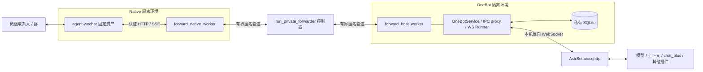
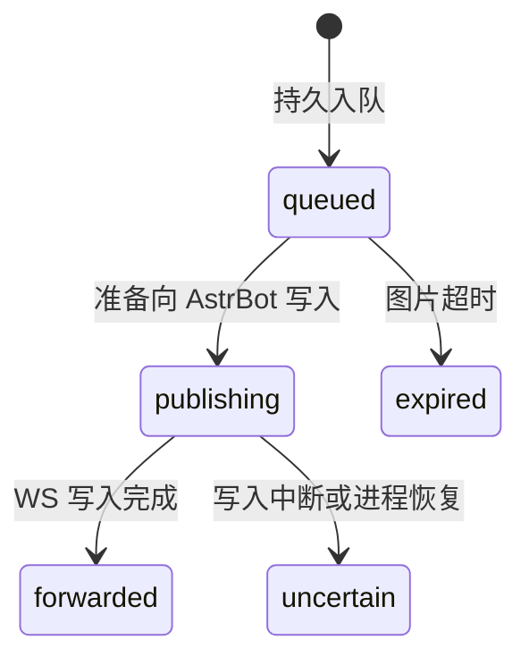

# MukPun-WeChat 开发文档

2026-11-16后续部署：用户要求启动桥后，发送隔离修复99dc7d6已实际上线，264文件视图匹配；新清单覆盖5项、ledger revision5，原Native复用，桥/SSE/WS/身份已核验ready。历史54项未知保留，私聊五媒体开启、群关闭。准确步骤、工具续接和实况见[启动记录](superpowers/plans/2026-11-16-send-isolation-start.md)，不能继续按下方较早“源码未部署/桥暂停”段落操作。

本文说明技术方案、架构、核心概念和继续开发的方法。当前架构更新：2026-11-14；已包含全群路由、成员名称、媒体及模块化正式路径。本文不表示整理时重新检查过云服务器，也不包含生产连接资料。

AI 接手先读 [AGENTS.md](../AGENTS.md)，功能及使用概览见 [README](../README.md)。阶段文档保留过程和验收证据；与当前代码冲突时，应确认代码及实际部署版本，不能把历史限制直接当成当前行为。

## 1. 技术方案与职责划分

目标是在 Linux 上复用已有 AstrBot，为微信提供受控的 OneBot v11 通道。桥不运行独立模型、不管理人格、不判断群消息是否值得调用 AI。消息处理链路为：



| 技术 | 选择与原因 |
| --- | --- |
| 微信接入 | `scripts/project_paths.py` 固定资产路径 `wx-v1.4.0-linux-x64-gnu`（原始基线已如此，本轮未升级）；实际二进制/部署版本另核对，历史 [v1.2 升级记录](native-1.2.0-upgrade.md) 不代表当前线上状态 |
| 桥语言 | Python 3.12；协议、状态和隔离控制可独立测试 |
| 入站传输 | Native SSE 推送；持久游标和事件摘要用于恢复校验 |
| 进程间通信 | 逐行 JSON 匿名管道；明确字段、大小、目标及请求回执绑定 |
| AstrBot 接入 | OneBot v11 Universal 反向 WebSocket；桥主动连接同机 AstrBot |
| 持久状态 | Python 标准库 SQLite，私有权限、有界容量和明确事务 |
| 运行隔离 | systemd / cgroup v2、非 root 工作进程、受限文件系统和用户态网络 |
| 外部依赖 | 运行依赖 `websockets==15.0.1`；模拟测试另使用 aiocqhttp、Quart、Hypercorn，版本见依赖文件 |

本项目的模块化重构借鉴了 [NapCatQQ](https://github.com/NapNeko/NapCatQQ) 的架构和实现：原生能力、OneBot 动作与网络通道分离，显式动作注册与统一异常边界，以及连接生命周期、健康状态和 worker 监督的职责划分。微信媒体由适配器转换后复用公共图片消息通道；微信身份、发送确认、持久队列和恢复机制保留本项目的约束。固定参考提交、对应源码与采用差异见[NapCat 对照表](modular-architecture-handoff.md#napcat-采用点与微信差异)。感谢 NapCat 开发者提供的参考。

转发组织也参考了 [Akasha-WeChat](https://github.com/alingalingling/Akasha-WeChat)。本项目运行于自己的 Linux Native、匿名 IPC 和回执链路。

## 2. 关键概念

| 概念 | 在本项目中的含义 |
| --- | --- |
| Native | 固定版本微信接入进程，持有微信会话和私有 API，提供消息、媒体和发送作业 |
| SSE | 服务端事件流；收到通知后按真实 ID 读取消息。不是业务成功确认，也不保证上游 SDK 内部绝对没有本地存储轮询 |
| 反向 WebSocket | 桥是客户端，AstrBot 提供 WS 服务端；Universal 通道同时传消息事件、API 请求和响应 |
| OneBot 事件 / action | 事件描述收到的消息；action 是 AstrBot 要桥执行的操作，例如 `send_group_msg` |
| `echo` | AstrBot 的请求关联值；必须原样带回响应，不能把它单独当成全局唯一消息 ID |
| 原始 ID / 数字 ID | 微信 ID 是真实身份和路由依据；OneBot 数字 ID 是持久映射，不能用昵称或临时 hash 替代 |
| 真实自身 senderId | 从已接受且投影核验的发送记录取得，用来过滤自身消息；与桥保留的 OneBot bot 身份区分 |
| 游标 / 锚点 | 游标表示事件位置；锚点是事件内容摘要，防止资料恢复后相同游标编号对应了别的内容 |
| 背压 / 有界队列 | 下游忙时控制读取与发送速度；达到容量应明确报错，不能默默丢消息。不是消息合并 |
| 幂等 | 已处理的同一动作返回保存结果，尽量避免网络故障造成重复提交；不等于任何故障下恰好一次 |
| `accepted` | 微信服务器接受且满足本项目核验；不等于对方已读，实际客户端交付仍需验收 |
| 投影 | SDK 将发送结果保存为可读取的本地消息，供目标、正文或媒体摘要核对 |
| `uncertain` | 可能已交付但无法证明的状态；必须保留证据，不能自动重发或重新调用模型 |
| 快照 / 租期 | 快照保存完整加密资料及数据库；租期限制单次运行时长。保存快照不保证信任永不过期 |

## 3. 模块与启动关系

### 正式运行入口

`scripts/run_forwarder.py` 读取版本化非敏感配置，并把已有控制器绑定到正式 `astrbot-wechat-forwarder.service`。控制器仍复用名为 `run_private_forwarder.py` 的模块；这个历史文件名不表示现行仅支持私聊。

控制器核验已有 Native 所有者、会话和资源边界，准备经过核对的代码副本，启动 Native 与 OneBot 工作进程，校验 ready 后允许转发，汇总状态与审计。OneBot 工作进程只持有连接 AstrBot 必需的 token；微信 Native 凭据不会交给 OneBot。

| 位置 | 责任及修改时的关注点 |
| --- | --- |
| `wechat_bridge/core/` | 消息/会话契约、路由/投递、持久入队、幂等发送与健康；注入平台策略，不依赖 SDK、OneBot 网络或 systemd |
| `wechat_bridge/adapters/wechat/` | Native/SSE、身份/群策略、消息/回执投影、无凭据 IPC proxy、配置装配和微信恢复后端 |
| `wechat_bridge/onebot/` | codec/content/frame/event、统一请求校验、ActionRegistry 与现有动作；组合 core 服务 |
| `wechat_bridge/transports/` | Endpoint、反向 WS 生命周期、鉴权、有界收发/重连/心跳；协议通过服务接口调用 |
| `wechat_bridge/storage/` | 既有 State/Spool、身份/动作/队列/路由/检查点，保持 schema/数字 ID/同步持久化 |
| `wechat_bridge/runtime/` | Controller、精确 worker unit/监督、每代状态、握手、IPC broker、媒体中介与错误分类 |
| `protocol.py`、`continuous.py`、`forward_gateway.py`、`transport.py`、`state.py`、`durable.py` | 旧导入/构造器的兼容层，正式实现归上述子包；不是第二套常驻消费者 |
| `wechat_bridge/forward_wire.py` | 正式 IPC 的有界帧、严格字段、增量行解析、健康/协议摘要握手 |
| `group_trigger.py`、`loop_guard.py`、`sender_names.py`、`image_*`、`voice_output.py` | 被适配/协议边界调用的既有微信规则、媒体与清洗辅助模块 |
| `scripts/forward_native_worker.py`、`forward_sse.py` | Native/SSE 正式装配/兼容导出；隔离视图显式映射到 flat `/opt` |
| `scripts/forward_host_worker.py` | 构造 Spool/HealthState/WeChatIPCBackend，调用 create_host → create_service → OneBotService / WS Runner |
| `scripts/run_forwarder.py`、`run_private_forwarder.py` | 配置、正式 CLI/unit、启动准入、预算/状态；监督和 broker 委托 runtime |
| `scripts/runtime_manifest.py`、`tools/sync_runtime.py` | 公开源码/角色清单、路径边界、代码副本与摘要 |
| `scripts/session_runtime*.py`、`session_state_store.py` | Native 所有者/完整会话、有限生命周期、受限快照校验与原子提交 |
| `scripts/media_egress.py` | 受限媒体许可，不扩展为任意 URL 下载代理 |

正式入站是 Native/SSE → runtime broker → IPC proxy / DurableInbox → MessageService → OneBot EventCodec → WS；出站是 WS → onebot frames/registry/content → DeliveryService → IPC/Native → 绑定回执证明。完整调用链、NapCat 固定参考/差异、兼容/进程边界和下一位 AI 的起点见[当前架构交接](modular-architecture-handoff.md)。

`wechat_bridge/gateway.py`、`ipc.py`、`scripts/bridge_*` 及 `poc-*` 文档保留单轮或早期验证路径。生产 IPC 是 `forward_wire.py`，不是早期 `ipc.py` 的 32KiB 上限。不要仅按同名类或文件注释判断实际运行路径。

### 源码、部署副本与状态

源码组织为 `wechat_bridge/` 和 `scripts/`，正式入口直接从 Git 工作副本运行。`project_paths.py` 派生 `.runtime` 私有配置、资产及 `verification` 视图；`tools/sync_runtime.py --apply` 按源码摘要更新视图并保留依赖。控制器另维护带入隔离环境的文件清单，新模块须核对打包、白名单及导入位置。旧 `poc-stage-01/` 仅保留回退及历史验证用途。详见 [目录布局](checkout-runtime-layout.md)。

公开模板中的 `/home/bridgeuser/astrbot-wechat`、`/home/bridgeuser/AstrBot` 是示例。当前脚本仍有实例布局约束，不是任意 clone 位置都能一键安装。

| 私有运行位置 | 内容 |
| --- | --- |
| `/var/lib/astrbot-wechat-session` | Native 保存资料、发送审计、验证绑定和预算；禁止上传 |
| `/run/astrbot-wechat-session` | 控制/状态文件及短期敏感资料；不是公开日志目录 |
| `/var/lib/astrbot-wechat-bridge/private-forward.sqlite` | 工作进程视角的 OneBot 身份、队列、游标和动作结果；实际宿主位置受 systemd 私有状态目录影响 |
| 实例的 `forwarder.json` | 实际联系人及非敏感功能配置；仍按私有配置管理，不提交 |

## 4. 入站链路：微信到 AstrBot

1. Native SSE 从已确认游标继续；恢复时对照锚点，不自动跳过缺失/冲突位置。
2. 按事件 ID 获取真实消息，核对 account、thread、direction、origin、创建时间、真实 senderId 与消息类型。不能用读取时间冒充消息创建时间。
3. 全群模式接受合法群 ID，首条消息建立路由；私聊只接受绑定联系人。出站/自身消息多层拦截。
4. 按需取普通图片，并解析展示名称；名称读取失败保留正文，图片失败按明确策略计数，不伪造图片内容。
5. 控制器和 WeChatIPCBackend / DurableInbox 再核对来源与负载。`Spool.admit()` 持久写入成功后保存 checkpoint 并 ACK，SSE 才继续。
6. `OneBotService.ingest()` 委托 core MessageService 建立稳定数字 ID、消息到会话绑定及 sender 信息，将队列标为 `publishing`，由 EventCodec 生成 OneBot 事件。
7. `Runner` 发送 OneBot 事件；网络写入完成后标为 `forwarded` 并删除队列正文。中断则记为 `uncertain`，不静默重新交给模型。

### 全群、唤醒与模型调用

`allGroupsEnabled=true` 为正式默认，包括旧配置省略该字段的情况。所有群的普通文本逐条上报；开启 `imageInputEnabled` 后，受支持普通图片也直接上报。`get_group_list` 返回已观察并映射的群，新加入但尚未发消息的群未必在列表中。新增群的显示名可能暂时为“微信群+数字 ID”，不影响稳定路由。

全群模式中，只有可信 `msgsource.atuserlist` 确认 @ 机器人才附加 OneBot `at` 段；普通文本和 `/ai` 不伪造 @，命令正文原样保留。`/ai` 的实际响应取决于 AstrBot 现有指令/唤醒设置。旧单群模式仍可按 `prefix`、`mention`、`mention_or_prefix` 准入，并可开启普通文本上下文上报；这两种模式不要混写。

消息进入 AstrBot 不等于每条都调用 LLM。上下文缓存、概率主动回复、图片处理范围、合并和模型选择由 AstrBot 及插件管理。排查时不得擅自关闭或改写用户已有插件策略。

### 群成员名称

按真实群和用户 ID 精确读取本地联系人/成员目录，将名称放入 `sender.nickname`、`sender.card`，不拼入正文。单次预算 0.8 秒；成功缓存 300 秒、缺失 30 秒，最多 1024 项，名称最多 256 UTF-8 字节。

名称不参与源消息去重摘要，避免改名使旧消息重投。资料缺失只使用占位名，不能猜同名用户；逐消息解析只做 GET，不自动全量同步。定向 `members/refresh` 是另一个有副作用的资料更新操作，不是普通只读查询。详见[成员名称记录](group-member-names.md)。

## 5. 持久状态与防循环

| 表 | 用途与边界 |
| --- | --- |
| `identities` | `(kind, raw)` 到数字 ID；bot/group/user/incoming/outgoing，最多 8192 项 |
| `submissions` | 动作键、请求摘要、Native 幂等键和结果；最多 4096 项，无结果的预留视为 unknown |
| `member_names` | 群+用户展示资料，最多 8192 项；不参与身份授权 |
| `inbox` | 有界待转发负载及状态，最多 32 条/2MiB；完成后删除正文，保留有限去重元数据 |
| `checkpoints` | Native generation 的游标/锚点、OneBot namespace、会话触发消息等 |
| `message_routes` | OneBot 消息 ID 到真实会话的有限绑定，用于同会话引用校验 |



防循环同时依靠真实自身 senderId、方向检查、源 ID/摘要、持久游标和出站动作幂等。不能用“相同文本”“相同昵称”或任意时间窗代替身份校验；用户重复发送同一句话仍是不同消息。

WS 不提供 AstrBot 已处理的业务确认。因此 `forwarded` 仅证明本次网络交接完成，不证明模型已回答；对无法确认的交接不自动回放，优先防止重复调用或重复外发。这是明确的可靠性取舍，不是严格 exactly-once 保证。

## 6. 出站链路：AstrBot 到微信

1. 解码 action，校验 `self_id`、`echo`、目标数字 ID 和允许参数。全群回复仅投到已经有持久映射的群；私聊只投指定联系人且保留最近输入后 600 秒回复窗口。
2. 校验完整消息链及引用归属。当前是文本，或一张受支持图片及可选同会话引用；不支持内容不能悄悄丢弃后报告成功。
3. 按 namespace、目标、触发消息和 `echo` 生成持久动作键；请求摘要校验冲突。无 `echo` 请求会生成随机关联值，不能承诺跨请求去重。
4. 已有动作返回缓存结果；新动作先预留再发送。文本按 UTF-8 字节分段，保留正文、换行及 emoji，受全局发送锁和间隔约束。
5. 通过 IPC 交给控制器与 Native，绑定 requestId、account、destination、幂等键及图片源摘要。提交只发生一次，随后仅查询该作业状态。
6. 只有真实接受回执及必要消息投影验证通过才返回 OneBot 成功。分段部分成功、超时或进入提交阶段后无法确认时，保留审计，不重发整条消息。

| 结果 | 后续行为 |
| --- | --- |
| 校验拒绝 / 确定未提交 | 返回明确失败；已识别的不支持图片或提交前失败不应中断其余文本 |
| 已确认微信接受 | 返回成功，保存消息 ID 和结果 |
| 可能已提交但结果未知 | 返回/记录 unknown；保存原动作和完整证据、不重发，后续消息继续。非终态持久 pending，由后台核对，不能将其当作恢复许可 |

常见桥返回值：`1400 invalid_request/unsupported_message_segment`、`1403` 路由/回复权限拒绝、`1408 outcome_unknown`、`1500 state_unavailable`、`1501 action_not_supported`。状态码说明的是桥的处理结果，不能统一解释成微信服务器风控。

图片本地作业创建成功不等于已发往微信。当前版本只有在 SDK 终态、阶段、server/native receipt 等条件证明为提交前失败时才认定“未提交”。不能仅凭看到某个阶段字符串或报错就重发。普通失败/未知不再关闭全局交付门，详见[发送隔离](superpowers/specs/2026-11-16-send-outcome-isolation-design.md)与[兼容修复](static-image-compatibility-fix.md)。

`needs_review` 不能只看阶段下结论。运行时必须取得与审计精确绑定的完整作业证明，满足对应发送器/恢复器的确定失败条件后才写拒绝并继续文本桥；恢复账本的 `rejected_before_submit` 还要求 `_pre_submit` 的正面失败证据。只有 `preparing/uploading`、零已发送字节或缺少回执不足以替代完整证明。不能证明的作业保留未知结果；经明确人工许可，可对精确记录登记隔离且不重发，不能改写为确定未送达。

## 7. 图片输入与输出

### 输入：微信普通图片交给 AstrBot

`scripts/image_native.py` 受限读取媒体，`image_input.py` 校验 MIME、尺寸、字节数、base64 和 SHA256，再转换为 OneBot `image` 段。单张输入最多 25MiB、边长 16384、总像素 100000000；所有图片默认写入专用临时文件并以 `file://` 交付，不再受 OneBot 单段大小限制。只有文件缓存已满时，128KiB 及以下的图片才退回内联 `base64://`，更大的图片则明确拒绝并保留文字。

桥收到 `type=3` 图片消息后，自己调用 `POST /messages/{id}/media-transfers` 申请原图下载，并按 job ID 接管该下载的临时 CDN 出口；不依赖 Native 的自动下载队列。前提是账号设置 `auto_download_max_bytes=0`，否则 Native 会先把缩略图排队下载，而缩略图任务同样占用按账号的单一媒体锁，原图要排在它后面，实测会多等 20 秒以上。该设置不在本仓库代码里，属于部署前提，迁移或重建账号后必须重新核对。

原图读取的期限为 75 秒，整体取图预算 80 秒；原图超时会重读一次资源列表，若标准图此时就绪则直接使用标准图，仍不接受缩略图。已知暂时性失败（`image_unavailable`、`image_timeout`）最多重试一次，第二次使用完整期限。

支持同会话引用；群内关联按同一群、同一成员及 90 秒窗口，防止把甲的图片配给乙的问题。全群模式还可直接上报普通图片。实际视觉能力由 AstrBot 的模型和插件决定；插件 `at_only` 等范围可能使图片没进入最终模型历史，应分别核对 Native 类型、桥交付和 AstrBot 原始事件。

原生 `type=47` sticker 由独立的 `stickerInputEnabled` 控制；默认关闭。开启时，微信适配器通过 `read_sticker` 获取并核验媒体，再复用普通图片的 IPC、文件和 OneBot image 通道。WXGF 仅交付 Native 静态预览并核对预览 MIME/长度/SHA256，GIF 等使用已验证字节；不承诺模型理解动画全部帧。取图不可用走 checkpoint/ACK 继续后续消息，不发送占位文本；策略/身份故障继续保护处理。普通图片与原生 sticker、输入与输出是不同能力。

2026-11-16用户已批准绑定私聊表情启用方案。`50c3077`仅把表情自身读取上限由75秒收紧到60秒，适配现有65秒hd_input租约；普通图片75秒及整体80秒预算保持。期限回归先失败后通过，表情专题、三条真实worker/合成HTTP-SSE用例和一条普通图片相邻用例共13项通过（3.206s），独立复审通过，未重跑全量。实际取图和部署状态以[表情启用方案](superpowers/specs/2026-11-16-private-sticker-input-design.md)、[诊断末段](sticker-input-diagnosis.md)及[灰度末段](private-canary-rollout.md)为准；不用历史probe批量探测或重启Native。

### 输出：AstrBot 静态图片发回微信

- 接受 `base64://`，不读 AstrBot 文件路径、不抓任意 URL。兼容固定范围的 AstrBot 图片段可选字段，仍严格校验结构。
- OneBot图片data仅额外接受`sub_type`严格整数0/1及`summary`最多256 UTF-8字节，兼容meme_manager的NapCat显示提示；它们不启用GIF或微信原生sticker，不改变图片字节。其余字段与不支持格式仍明确拒绝。2026-11-15复现、修复和切换边界见[图片元数据设计](superpowers/specs/2026-11-15-onebot-image-metadata-design.md)。
- 该兼容修复cb691c9已同步正式源码/显式视图，62项相关测试通过。切换中两次停止异常已保存并经精确证据复核，具体触发原因未证；禁止将它们记作clean stop或套用旧部署工具盲目重启。实际就绪与剩余限制以[灰度末段](private-canary-rollout.md)为准。
- 支持单张 PNG、JPEG、静态 WebP；最多 8MiB，超过拒绝，边长最多 2048，总像素最多 4×1024×1024。
- WS action 预算 16MiB，生产 IPC 单帧 256KiB；图片大于 128KiB 时用 64KiB 原始块逐块 ACK，完整组装校验后提交。
- 组装期限随块数增长（`20 + 块数×2` 秒，上限 300 秒），提交另有独立 85 秒预算，不能借用组装时间；组装超期只报告确定未提交并不终止工作进程。详见[图片管道传输超时与中转恢复](forwarder-pipe-recovery.md)。
- 上传包含准备、上传、读回、提交和投影核验；SDK 可能重采样成 JPEG，不保证源文件字节不变。
- 拒绝 GIF/APNG/动画 WebP、多图、图文混合及原生 sticker 输出；不能把源图不支持统一当作网络超时。
- 持久上传计数保留旧值，有限计数上限为百万次；失败预留也计入。实际准入检查数据库、存储和内存余量，不能清空预算绕过容量门禁。新上传按 `max(1MiB, 2×源大小+512KiB)` 预留增长，并保留 16MiB 存储及 64MiB 父组内存余量。

`image_source_cache.py` 按已核验源摘要复用同一 Native 运行期上传，最多 64 项、24 小时；切换 Native 运行期自动失效。`media_cache_maintenance.py` 仅在 Native 停止后处理离线快照副本，回收已确认完成发送的过期上传源，保留全部其他表和资料文件。新增空闲维护 timer，在 500MiB 缓存预算或安全余量门槛触发时，备份并短暂停启 Native，回收已完成图片和语音上传源；仍不能当作完整 SDK 媒体资料生命周期管理。详见 [容量说明](image-8m-storage-128m.md)。部分素材仍可能在上游准备阶段失败；已有实际交付证据不应重复触发。

## 8. 配置与协议边界

正式配置 `schemaVersion=1`，字段集合封闭，拒绝重复键、未知字段和非法常量；配置原始字节最多 4096。完整样例见 [config.forwarder.example.json](../config.forwarder.example.json)，其中无任何认证材料。

| 配置 | 含义 |
| --- | --- |
| `privateContact` | 精确绑定的私聊联系人显示名；后续使用已验证原始 ID 投递 |
| `privateOnly` | 严格 bool，默认 false；true 覆盖群设置，只允许绑定联系人，关闭群入站/出站。false 的 allGroupsEnabled 单独仍表示旧单群 |
| `allGroupsEnabled` | 默认 true；省略时也开启。若改为 false，恢复旧单群模式 |
| `groupName` | 旧单群目录/验证；不是全群模式白名单 |
| `groupPrefix` / `groupWakeMode` | 旧模式唤醒，前缀固定 `/ai `；全群正文不因此改写 |
| `groupContextEnabled` | 旧单群普通文本准入；全群模式已接受普通消息 |
| `imageInputEnabled` / `imageOutputEnabled` | 媒体能力开关，样例默认 false，不代表线上当前开关 |
| `voiceOutputEnabled` | 接受AstrBot的合规record/WAV并交付原生语音，不自动生成TTS |
| `linkInputEnabled` | 将受支持分享卡片的标题、摘要、链接等文本上报，不自动抓取全文或发送原生卡片 |
| `runtimeSeconds` | 600～604200 秒；Native 单次最长 604800 秒，桥还受剩余租期约束 |
| `sendIntervalSeconds` | 5～60 秒，默认 5 秒 |
| `segmentBytes` | 1024～8192 UTF-8 字节，默认 8192 |

更改配置不是热更新；实例文件建议 `0600`。当前控制器从项目外既有 AstrBot 配置获取 OneBot 令牌，通过匿名管道传递，桥连 `ws://127.0.0.1:6199/ws`；端点契约禁止任意远端 URL。修改端口需核对两端及校验逻辑，不能在公开配置里加密码。

2026-11-15用户授权在绑定私聊中开启图片收发、语音输出和链接卡片输入，群继续关闭；实际切换状态见[灰度最新记录](private-canary-rollout.md)，边界见[启用设计](superpowers/specs/2026-11-15-private-media-enablement-design.md)。不能再把早期“全部媒体关闭”当作永久配置。切换前发现systemd子捕获`After`停止顺序误触发review，改为`Before+BindsTo`，捕获清理先EOF撤销，再对确切unit signal-first及异步stop、验证终态/PID0/原cgroup空；其他unit仍用原同步stop。重复close只在已成功清理后短路。已有模块清单覆盖改动，无新增运行模块。

2026-11-16用户确认图片/语音正常；链接未到达的现场原因是host exit1后桥已worker_failed停止，卡片在其后才到达。实际Native GET已证明type49/app5/link与`[Link]`文本投影正常，无需改解析器。完整准入与原Native/精确两条未处理输入核对后，仅一次受审warm-only启动恢复原游标消费，received/forwarded均2且捕获结束后新鲜ready。生产源码/配置未改，不重跑测试；host原始异常尚未定位，恢复不能记成稳定性修复。见[分享卡片输入](link-input.md)及灰度末段。

2026-11-15启用阶段已上线`37ff509`并在原warm-only入口中收紧为“四能力true、privateOnly true、sticker/groupContext false”的精确断言；当时新鲜ready和原Native在线证明通过。开发专题89项及真实systemd三场景通过，不重复全量。恢复journal仅在完整证明、备份目录与父目录fsync、实际加载ExecStart核验后归档；该启用阶段结束时尚未重新验收真实媒体交付，后续用户确认与现场结果见灰度记录。

OneBot 支持 `send_msg/send_private_msg/send_group_msg`、基本登录/状态/版本、已观察群及成员展示信息查询、`can_send_image/can_send_record`、消息事件和心跳/生命周期。好友查询只有配置联系人；没有完整成员目录、历史检索、群管理、请求/通知、语音输入、视频或合并转发。已有受限语音输出；早期 `get_msg` 分支不代表常驻历史 API，协议字符串 `v11` 不代表所有 API 都实现。

## 9. 运行保护与恢复原则

| 资源 | 现有边界 |
| --- | --- |
| Native 父资源组 | max/high 3072/2816MiB、20% CPU、32 tasks |
| Native SDK 及会话控制进程 | max/high 2560/2304MiB，共享 Native 父组限额 |
| Native 转发工作进程 | max/high 96/72MiB、4 tasks，共享 Native 父组限额 |
| OneBot 工作进程 | max/high 128/96MiB、10% CPU、8 tasks |
| 控制器 | max/high 1024/768MiB、100% CPU、16 tasks；恢复需物化快照和 Control DB |
| Native 私有 tmpfs | 缓存预算 500MiB；临时卷总计 2GiB；单文件保护 768MiB |
| 文本 / 队列 | 文本 32KiB；输入队列 32 条/2MiB |

这里只描述源码限制，排查线上必须读取实际 cgroup 和部署版本。内存 high/max、tmpfs、数据库文件上限和媒体预算保护不同资源，不能相互替代。

完整会话包括 registry、加密密钥、各账号数据库和 managed profile；只保存一个 cookie 或零散复制主 DB 不足以恢复。停止应保留最终一致快照，恢复在私有副本内处理必要 SQLite rollback，再只读完整性检查并拦截待发/未知 outbox。不能删除 journal 当作修复，也不能改写唯一原始快照。

常规桥重启保留 Native 会话；Native 会话恢复禁止自动 fresh login。断网、5xx、DNS、资料解密或资源错误先诊断，不能直接要求扫码。当前没有无限期运行保证，不能在没有设计和验收的情况下自动续租。

必须保护已有 Docker、AstrBot 和 FRP，不改宿主模块、防火墙、路由或现有映射。只操作本项目精确 unit/PID/命名空间，保留前后基线。历史内核模块脚本和定向恢复工具不是通用安装/运维命令。

## 10. 本地开发与验证

```bash
python3.12 -m venv .venv
# Linux / macOS
source .venv/bin/activate
# Windows PowerShell：.\.venv\Scripts\Activate.ps1
python -m pip install -r requirements-test.txt
python -m unittest discover -s tests -p "test_*.py" -q
python -m wechat_bridge.simulation
```

需要复现依赖组合时使用 `requirements-test-lock.txt`。本地模拟使用合成数据与本机监听，不需要微信或 LLM 凭据；涉及回环 socket 的用例仍需环境允许本机网络。

| 改动 | 优先测试文件（位于 `tests/`） |
| --- | --- |
| OneBot 参数、JSON、WS | `test_onebot_bridge.py`、`test_onebot_action_transport.py`、`test_onebot_simulation.py` |
| 持久队列、连续回复、IPC | `test_onebot_continuous.py`、`test_onebot_continuous_wire.py`、`test_onebot_native_forward.py` |
| 全群、唤醒、上下文 | `test_onebot_all_groups.py`、`test_onebot_mentions.py`、`test_onebot_context.py`、`test_onebot_routing.py` |
| 自身过滤、幂等 | `test_onebot_loop_guard.py`、`test_onebot_continuous.py` |
| 昵称与名片 | `test_onebot_sender_names.py`，同时覆盖同源事件改名不重投 |
| 图片输入 | `test_onebot_images.py`、`test_onebot_native_forward.py` |
| 图片输出、预算与失败阶段 | `test_onebot_image_output.py`、`test_onebot_image_output_native.py`、`test_onebot_image_output_budget.py`、`test_onebot_output_policy.py` |
| 会话恢复与快照 | `test_session_state_store.py`、`test_session_resume_protocol.py`、`test_session_runtime*.py`、`test_onebot_boot_restore.py` |
| 媒体网络 | `test_onebot_media_egress.py` 及对应隔离验证 |

可只选相关测试，例如 `python -m unittest discover -s tests -p "test_onebot_all_groups.py" -q`。纯文档修改检查链接、描述与脱敏即可，不需重复整套回归或真实模型测试。

历史最新记录为本地 681 项（27 项平台跳过）、Linux 受限 OneBot 240 项通过，详见[成员名称与恢复记录](group-member-names.md)。这是已有记录，不是本次文档任务重新执行的结果。Windows 跳过的权限、POSIX 管道和 systemd 用例需要 Linux 对应验证，合成测试也不能代替真实交付验收。

## 11. 继续开发的流程

1. 在本地确认当前分支、工作区和任务边界；查阅对应源代码与专题，不从旧聊天推断线上健康。
2. 明确改动属于协议、控制器、Native 适配还是 AstrBot 策略；不在桥内增加模型密钥或重复消息合并。
3. 本地实现及适当回归；跨 IPC 增加字段或模块时同步检查字段白名单、两个工作进程、控制器和打包清单。
4. 若任务涉及部署，先核对目标实例、现有服务状态、剩余租期、队列、未完成发送、资源和备份；部署前后比较本项目与 Docker/FRP/网络基线。
5. 仅更新本项目，优先只重启桥。失败时保留审计，按实际状态判断是否可以恢复，不运行不适用的 `restore_*` 或 `reconcile_*`。
6. 尽量用已有消息与只读证据验收。额外真实发送须明确目标、内容/类型、数量和是否消耗模型额度；旧一次性授权不可复用，不确定结果不重发。
7. 更新文档与验证记录，明确代码已改、是否部署、是否实际交付；不扩大既有验收结论。

在完成既有实例适配后，可用 `sudo python3 -I -B /home/bridgeuser/astrbot-wechat/poc-stage-01/run_forwarder.py status` 查看状态。它只是示例路径；不要把 `restart`、`promote`、`install` 或旧恢复脚本当作了解项目的第一步。

## 12. 常见排查路径

| 现象 | 优先核对 |
| --- | --- |
| 完全不回复 | 先看 `native_connected`/`native_connection`（微信长连接本身）；再看桥 ready、SSE、astrbot_connected、队列和 self_identity_verified；最后看 AstrBot 唤醒/插件/模型，不能先扫码 |
| 普通群消息没触发 AI | 先确认事件是否到 AstrBot；收到事件与是否调用模型是两回事 |
| 群图片没进模型历史 | Native 是否 type3/type47、图片开关和计数、AstrBot 原始消息段、插件图片处理范围 |
| 昵称是占位名 | 当前发言人的精确 ID 是否有本地目录资料；不要用模糊同名搜索或全量刷新代替诊断 |
| `1400 unsupported_message_segment` | 图片开关、base64 源、单图链结构、格式/尺寸/字节数及无正文拒绝指标 |
| API 超时 | 分别检查 WS action 4MiB、IPC 帧 256KiB、分块 ACK、作业阶段和回执绑定；不能只统一加大 timeout |
| 桥停止且 requires_review | 保留 queue/submission/完整异常审计，核对独立身份、存储、恢复证据故障；普通发送 unknown 本身不应产生此门禁，不能清库强启 |
| Native 恢复失败 | 完整保存资料、SQLite journal/outbox、密钥、路径、容量与租期；不自动 fresh login |

日志和诊断输出仅保留必要计数、错误码和经审查的元数据。不要把原消息、base64 图像、完整真实 ID、令牌或配置原文直接粘贴进公开 issue。

## 13. 待办、明确不做与发布

已验收：指定私聊/群连续文本、上下文、原生 @、防循环、普通图输入、静态图输出及实际插件交付。后续扩展已包含全群自动路由及真实群成员展示名称，但多群长期运行、完整七天及异常恢复仍需持续验证。

后续由用户选定范围再推进：长期生命周期、媒体缓存安全回收与预算生命周期、通用安装与路径配置、更多 OneBot 能力、WebUI 及在线配置设计。WebUI 不能直接暴露 token、profile 或任意 shell；具体方案尚未确定。

缓冲合并由 AstrBot `chat_plus` 负责；原生 sticker 输入按独立开关和本次批准的私聊范围验证，不反复测试其他媒体。原生语音输出已实现；视频、完整群管理等不是已实现能力。

提交只允许源码、测试、文档与已审合成样本。禁止任何 API Key、密码、SSH 密钥、OneBot/Native token、真实配置、二维码、会话/profile、运行数据库、快照和真实聊天媒体；不得从实例目录整体复制并提交。

```bash
git diff --check
python tools/audit_publication.py .
git diff --stat
git diff --cached --stat
```

审计工具只输出规则/文件/行号，不输出候选密钥值；它是辅助检查，仍须审查实际暂存差异。用 `.gitignore` 排除 `.publish/`、运行资料、虚拟环境和生成发布副本，不能将忽略规则当作“历史提交一定无敏感数据”的证明。

相关专题：[文本转发](plan1-text-forwarding.md)、[防循环](plan2-loop-protection.md)、[群上下文](group-context-forwarding.md)、[图片输入](plan3-image-input.md)、[静态图片输出](static-image-output.md)、[会话生命周期](session-lifecycle.md)。

## 模块化重构：当前与阶段历史

六阶段源码重构与交接已完成，最终整体静态复审通过且无剩余发现。当前结构见本文第 3 节及[架构交接](modular-architecture-handoff.md)，提交/精确命令/结果见[进度](architecture-rewrite-progress.md)。1232 项全量已在 `0452ba7` 通过；Task 6 沿用该证据并只补实际改动覆盖，systemd isolated 尝试因 sudo 需要密码未执行。未部署或验证真实宿主重启。

以下 Task 1–5 小节保留各阶段形成时的实施记录。其“待后续实现/待全量/待复审”表示当时状态；当前结论以本文当前概览和进度表为准。

## 2026-11-12 模块化 Task 1（独立复审通过）

`wechat_bridge/core/contracts.py` 现在持有原有 `NativeMessage` / `Receipt` 的唯一类定义；`protocol.py` 保留原名导出、字段、构造参数和 IPC/asdict 表示。新增的 `Conversation` / `ConversationKind`、`SendResult` / `SendOutcome`、`Capabilities`、`Health` 与 `PlatformBackend` / `PlatformPolicy` 只定义小型平台边界，不包含微信后缀、HTTP、OneBot 网络或进程管理。协议、适配器及健康正式调用路径在后续任务接入，不能把这些类型当作已完成后续阶段。

`wechat_bridge/storage/state.py` 与 `storage/durable.py` 是既有 SQLite 实现的移动，旧 `state.py` / `durable.py` 兼容导出相同 `State`、`StateError`、`Spool` 类对象。没有 SQL、schema、ID、echo、序列化或 publishing → uncertain 行为变更；保留同步写入设置。

`tools/sync_runtime.py` 使用 `scripts/runtime_manifest.py` 的显式 `PUBLIC_CODE`，按确定顺序同步子包及 `__init__.py`，仍生成根 `run_onebot_tests.py` 别名。新增公开模块必须登记 inventory；新增 Native 依赖同时更新 `NATIVE_SOURCES` 目标→源映射。控制器 `FILES` 与 Native `CODE_FILES` 共用该角色清单，保留现行 flat `/opt` 布局、0444/root/单链接/文件大小/只读挂载检查；OneBot 的现有只读视图再核对 host 角色所需包文件。后续 adapter 子包交付必须同时扩展映射和 worker 导入，不能挂载完整工作副本。

同步前核对所有源、目标和上一代清单中的路径，拒绝目录/文件符号链接、路径穿越、staging、隐藏或私有资产路径。只清理上一代清单登记且仍属于公开代码路径的旧源文件；保留 `onebot-env` 与 data。未登记的文件不进入视图；已有旧视图中的未登记文件不会被自动删除。`.superpowers` 草稿/复审包已从发布审计输入排除。

验证命令和 NapCat 对照见 [阶段记录](architecture-rewrite-progress.md)。专题测试使用私有 tmpfs 临时目录避开宿主 ext4 journal 阻塞；生产 SQLite 设置没有降级，该结果不证明物理掉电持久性。全量、systemd 隔离验收与部署尚未执行于本阶段。


## 2026-11-12 模块化 Task 2（历史实施记录；现已独立复审通过）

正式 host worker 现在装配 `adapters.wechat.proxy.WeChatIPCBackend`；旧 `forward_gateway.Gateway` 导出同一个类。它只持有账号/路由、持久存储和匿名 IPC 发帧回调，不接受 Native token，也不导入 SDK 客户端。文本、图片、语音沿用既有完整内容校验、单请求绑定、分块 ACK、源摘要和回执绑定；IPC 帧、超时及媒体预算保持原值。

`core.delivery.DurableInbox` 提取原有原子入队/检查点提交、提交后 ACK、恢复阻塞和队列消费顺序。游标的十进制格式、锚点校验及原有 JSON 字节格式属于 `adapters.wechat.policy.WeChatPolicy`；共享投递层不解析微信游标或 ID 后缀。WeChatPolicy 同时实现会话种类/自身来源判断及指定私聊、单群/全群准入。`adapters.wechat.messages` 持有原有展示/媒体消息类及投影，`continuous` 保留同名导出；字段、asdict/IPC 表示不变。`receipts.send_result` 提供三态证据投影，不能替代既有绑定与媒体投影证明，也不授权重发；正式 wire 仍保留原有回执/flags。

`adapters.wechat.native` 收纳原有 Native SDK 装配、真实身份核对、接收投影和媒体/文本操作，继续委托现有低层 HTTP/媒体实现。`adapters.wechat.sse` 是原 SSE 实现的移动：仍只有一个消费者，未获持久 ACK 不推进重连游标，恢复先核对锚点。`scripts/forward_native_worker.py` 与 `forward_sse.py` 成为兼容装配/导出入口。Native 仍平铺 `/opt`：显式映射 `wechat_native.py` / `wechat_sse.py` 到包源码，原有 per-file 校验/挂载及凭据边界不变；checkout 的 `-I` 导入和独立平铺角色视图均有合成验证。

新增 `test_wechat_adapter.py` 覆盖公共适配器入口、私聊/群来源、自身过滤、真实 Spool 提交后 ACK、冲突不推进游标、完整文本/图像/语音及回执绑定/三态结果，并登记到受限 runner。具体 RED/GREEN 与本地 NapCat 对照见阶段记录。本阶段未完成 OneBot 服务拆分、网络/健康/监督，也未运行全量或真实 systemd 隔离验收、未部署。


## 2026-11-12 模块化 Task 3（历史实施记录；现已独立复审通过）

正式 host 通过 `adapters.wechat.assembly.create_service` 装配 `onebot.service.OneBotService`；它组合 `core.messages.MessageService`、`core.sending.DeliveryService` 和 `onebot.registry.ActionRegistry`。旧 `continuous.PrivateBridge` / `TextBridge` 保持导入、构造参数及二者的类继承关系，只做兼容装配，不再继承旧 `protocol.Bridge`。`protocol` 保留旧公共导出；单次触发 Bridge 的旧窗口/仅一次回复语义单独保留在 adapter 的 legacy 兼容入口，正式 host 不构造它。

`onebot.codec` 持有原有有界 JSON、重复键/不透明 echo、数字 ID 和响应封装；`events` 构造消息/元事件及名称展示；`actions` 的发送、状态/能力和目录处理器由显式注册表分发。所有 action 先校验完整请求外层、echo、params 类型及 self_id，再调用处理器；修复此前私聊好友查询/拒绝群发送分支绕过公共校验的问题。保留既有 action 子集、返回码、消息段白名单及 `send_private_msg` 的持久摘要规范化，不增加 NapCat 的 action 别名。

`core.messages` 负责稳定身份/会话路由、publishing/handoff、触发游标和回复窗口；`core.sending` 只消费完整预校验的 `PreparedSend`，保留动作预留、源会话/触发/echo 幂等范围、分段顺序、部分发送与未知结果审计。UTF-8 分段位于 `core.text`，保留 CRLF/空白原文。微信源检查、群种类、唤醒/正文及严格文本回执证明由注入的 `WeChatPolicy` 提供；core 不解析微信 ID，不导入 adapter 或 OneBot。新增非微信会话 `topic:blue` / `member:red` 的合成后端测试。图片/语音继续使用既有有界验证、绑定回执和上传超时，不改变 IPC/schema/SDK。

新观察群的身份分配仍按群 → 消息 → 成员的原顺序；旧构造器携带 room_id 时的目录查询继续兼容。状态库、时钟及能力开关的旧可变访问通过同一组件状态读取，避免重开数据库后继续引用旧连接。所有新增模块/测试均登记 `PUBLIC_CODE`，host 角色和干净代码视图导入通过；Native flat `/opt` 清单无需新增源。

定向验证 264 项通过，包含真实 aiocqhttp 的本地合成 WS/SSE/IPC/分块媒体回环、OneBot/状态/幂等、微信适配器与架构交付。测试使用 tmpfs，未改生产同步写入；存在一条 0.353 秒 asyncio 慢任务诊断，未屏蔽测试失败。RED/GREEN 命令和 NapCat 固定参考差异见[接力记录](architecture-rewrite-progress.md)。网络/配置/健康仍待 Task 4，监督/恢复拆分待 Task 5，全量与隔离集成待 Task 6；本阶段不部署。


## 2026-11-12 模块化 Task 4（历史实施记录；现已独立复审通过）

正式 host 通过 `adapters.wechat.assembly.create_host` 将既有 worker 配置转换为服务选项与内部 `Endpoint`，注入存储、无凭据 backend、健康状态、墙钟和单调时钟，再调用 `create_service` 并装配唯一的反向 WS runner。入口保留现有默认路径和端点；测试可显式注入路径/工厂，不增加公开配置字段、热重载或传输。`transports.reverse_ws` 只管理连接和有界收发，协议服务的 `handle_frame` 负责 `onebot.frames` 解码、错误/echo 与动作分发。`transport.py` 保留旧导出及连接工厂兼容点。仍只允许 `ws://127.0.0.1:<port>/ws[/]`，正式端口 6199；认证头、16MiB action、256KiB IPC、15 秒心跳、ping/open/close/队列/写限额和 1/2/4/8/16/30 秒重连后 300 秒冷却保持。

`core.health` 提供两端共用的严格健康记录和计算。控制器每次状态发布把同一条不含凭据的记录放入状态文件 `health` 并通过有界 `kind=health` IPC 发给 host；记录绑定 `observed_at`、原探测 `native_checked_at`、Native 连接/探测码、SSE、WS 和恢复准入。Native 证明有效期为 `2*30+15=75` 秒，重新发布不会延长原探测时间；没有额外更短的 IPC 有效期。未知、探测失败、时间倒退或超期均不能报在线。`online` 表示真实账号的新鲜在线证据；`good`/控制器 `ready` 还需要 SSE、WS 和恢复准入，host 本地 WS 断开立即让 `good=false`。`get_status` 与心跳使用同一方法，保留原有 online/good 返回形状。消息/发送层原有连接和 activation 门控仍单独保留；不能把账号在线当作发送许可。旧模拟构造器可不注入健康对象，继续使用显式合成 backend。

本阶段纠正计划前提：旧 `verify_role` 只检查文件存在/类型，sync 的摘要没有参与握手，旧 `AWG-READY` 也没有版本。现在 controller 与 host 在启动配置/isolated 帧中协商 IPC 协议版本 2 和完整 host 角色源码 SHA-256，再使用绑定同一摘要的 `AWG-READY/2`。控制器按当前源码清单计算期望值，host 按实际只读代码视图计算；旧版本、混合代码或旧 ACK 在 ready 前拒绝。此协商只覆盖发生变化的 controller-host 通道，不宣称 Native 旧握手已版本化。现有 OS 隔离/文件所有权/只读/资源校验继续执行。新 health helper 显式加入 Native flat `/opt/health.py` 映射，以兼容 `forward_wire` 在 Native 和控制器 `-I`/importlib 下的独立加载；其他新文件全部登记 PUBLIC_CODE/host 角色。

NapCat 固定本地提交的 `network/index.ts`、`adapter.ts`、`websocket-client.ts`、`config/config.ts` 和 `action/system/GetStatus.ts` 用作职责参考：采用网络生命周期与动作服务分离、从真实账号状态取在线值的思路。保留本项目严格 JSON、端点/预算、未知结果与单消费者策略，不照搬 QQ、JSON5、多传输、热重载或 `online ?? true` / `good=true` 的乐观默认。具体 RED/GREEN、实际 `python -I` 拷贝视图握手和管道验证见[接力记录](architecture-rewrite-progress.md)。未运行最终全量或真实 systemd 隔离验收；无部署、真实消息、模型或服务/宿主网络操作。监督/恢复模块化仍留 Task 5，最终集成留 Task 6。


## 2026-11-12 模块化 Task 5（历史实施记录；现已独立复审通过）

正式 `run_private_forwarder.serve` 使用 `runtime.Controller`、`Workers` 与 `State`，每轮由 `controller.poll()` 处理两端故障、握手和 IPC；`session` 负责身份/摘要/游标准入，`broker`、`output`、`reports` 分别处理入站中介、完整发送/媒体块及报告。入口仍负责 CLI、配置绑定、资源预算和状态采集。runtime 持有入口模块的实时引用，保留正式 wrapper 注入的 UNIT/STATUS/ENTRY/SETTINGS，不从新包路径重算实例目录。没有新增进程或第二个消费者。

错误帧、管道传输错误和进程退出先按原始原因分类，再输出固定诊断；同一代同一 worker 只计一次，主动停止另一端不算崩溃。只有明确进程/连接/就绪故障允许受预算恢复；未知、身份、证据、配置和权限错误保持阻塞。每角色保持 10 秒内第三次故障停止。重启两端前必须确认精确旧 unit/cgroup 已停止，持久化待决发送处置，将 publishing 记录退休为 uncertain，并关闭媒体许可；任何一步失败都不能继续拉起。然后重建语音/图片输入 relay、请求/ACK、隔离/连接状态、回复权限和媒体 lease；语音构造器仍检查旧未知审计。Native 会话、完整恢复准入与昂贵快照证明只在控制器启动时执行，worker 重连保持已核验的游标和锚点，不退回 Native 最新边界。

`native_armed` 表示 SSE pump 已启动，不能证明 SSE 已连接；只有实际 `sse_connection=true` 和 host WS 已连接、握手完成，才发本代一次的 activate。连接报告在 armed 前后均可处理，WS 暂断等待恢复，不重新选择游标。持久恢复日志的 ready 转换在控制器生命周期中只提交一次；每次换代仍重新握手和激活。状态文件/get_status/心跳继续使用 Task 4 的同一 75 秒 Native 健康证明。

微信恢复后端保留单线程循环安全点同步捕获：无待决请求、语音、图片输入传输或图片组装才运行；没有后台快照并发。自审修复 reconcile 失败后仍落到空 replay barrier、误报 ready 的路径，证据冲突立即保持 review，不发布新保护或继续第二次 capture。schema、ID、IPC 表示、持久顺序、SDK、资源和媒体预算保持。

独立复审指出的准入缺口已修复：保留的 `requires_review`/`capacity_requires_review` 现在同时是投递准入的停止条件，不再只影响心跳与状态展示。`session.admit_activation` 让换代后的 `activate_if_ready` 在审查未清除时拒绝发出 `activate`（冷却启动的 `pending` 仍可正常激活，否则首次准入会自锁）。`Controller.review()`/`stop_for_review()` 在每轮 `poll()` 之前、以及正式 serve 在 `capture_if_safe()` 安全点证明失败后的同一次迭代内生效：停止精确 unit、按 `RecoveryBackend.retire()` 持久退休 publishing、关闭 capture，然后抛出 `failure(stage='requires_review')`。正式入口把 `requires_review` 纳入阻塞与永久退出集合，因此故障会被写入 `recovery-startup.json`，空出的队列既不自动重放也不自动清除审查，也不会 spawn 替代代。没有后台重试、没有新增 IPC/schema。

新模块与测试已登记公开/角色清单和受限 runner；Native 继续 flat `/opt`，错误分类 helper 映射为 `worker_failures.py`。NapCat 固定参考 `packages/napcat-shell/napcat.ts` 用于进程所有权、主动停止和短窗口监督；本项目要求停止与证据退休明确成功，不采用无法终止旧进程后继续启动、快速登录或宽泛进程树清理。RED/GREEN 和验证范围见[接力记录](architecture-rewrite-progress.md)。本阶段未部署；最终全量、真实 systemd 隔离与独立审查仍由 Task 6/后续审查完成。


### 私信灰度（2026-11-13）

用户已授权先仅指定私聊、纯文本，由用户发起一条短文本，最多一次简短模型回复。`privateOnly=true` 通过正式 controller → Workers 配置传到 Native/host；有效 allGroups=false、roomId=None，不读取单群绑定。正式 host 仍带 selfSenderId/selfProof、锚点和 require_activation，保留私聊名称、分段及发送间隔；Native/core/IPC 三处限制目标。旧群 selfProof 的验证目标只在函数内扩展，不修改 live allowlist。

旧配置缺少 allGroupsEnabled 时只补该字段，不能覆盖已设置的 privateOnly。旧队列不清空、不另建 DB；启动前必须核对无 queued/publishing，未知发送沿用恢复账本处置和保护。新增边界放在原有测试套件，无新增运行模块或角色依赖。

运维工具 `tools/inspect_private_canary.py <已部署源码目录> [--recovery-proof]` 仅输出布尔/枚举/计数，普通检查不启动任何 unit；proof 复用 selected_pair/_admit 的私有临时数据库证明，不修改会话/账本。`tools/deploy_private_canary.py --apply --expected-commit <已审阅提交>` 只从已更新的正式副本运行，要求桥停止、Native 在线、队列无待决、最新审计接受或已处置。它备份私有配置/unit，设 privateOnly=true 并关闭媒体/链接/上下文，sync_runtime 后只启动本项目桥。首次灰度以本项目 /run unit drop-in 临时设置 Restart=no，并校验后把本项目 alert.conf 改名为 alert.conf.private-canary-paused 暂停失败通知；不影响 worker 的内部故障恢复。验证结束后把该暂停文件移回原 alert.conf、移除工具创建的精确 /run drop-in 并 daemon-reload，可恢复原控制器重试/通知策略；不能顺便打开群。

本轮新6项边界通过；受影响84项现有用例通过；额外发现的 legacy/privateOnly 覆盖问题先复现再修复、单项通过。全量沿用0452ba7记录，不重新跑全量。真实服务切换和用户消息结果见[灰度记录](private-canary-rollout.md)。

私信灰度真实启动发现的旧故障：image_send_recovery 的精确GET须使用 `/v1/accounts/<account>/jobs/<jobId>`，不能拼成 sends。Native图片发送器也使用jobs；恢复只GET现有作业，不POST。预检必须使用recovery_dispositions.AUDITS全清单，包含forward-image-live-send.json，不能只核对被冻结的旧图片。详见灰度实况。

Native owner不在时，不能复用旧online字段或强行调用PinnedNative。灰度工具的`--offline-evidence`仅检查既有自动快照、当前桥SQLite的只读连接、完整AUDITS和处置覆盖，并给出身份种子、游标锚点和私聊积压计数。needs_review/uploading、零字节/无回执不自动等于确定未提交：仍以严格_pre_submit证明为准。新增未知作业须用户明确处置，不能继承已有Native例外许可；恢复必须包含该作业的保存快照并保留旧桥动作结果。

用户已明确批准本次唯一live图片的未知隔离与保存会话恢复。恢复准备仅使用既有快照，保留完整待决清单、旧审计与桥动作；维护timer在首轮暂停，先单独调用正式协调器到receive_ready，再用`--receive-backlog`只读复核持久锚点之后的私信，不移动游标，随后才能启动OneBot。恢复来自已有自动快照，不能称为停止瞬间的最终资料。实际结果仍以灰度记录为准。

私信灰度实况发现：SSE的`media.auto-download`缩略图通知也必须受Native的`imageInput`能力开关控制。禁用图片输入时不能发送media_wait/prewarm；该非文本事件仍走原checkpoint/ACK路径，避免可选媒体通知中断文本。控制器的媒体帧严格校验继续保留。

最新灰度已在4898d97达到真实ready：Native认证在线、SSE/WS已连接，仅指定私信、群及媒体关闭。四项未知发送隔离完整，未重发；当前真实消息/模型调用仍0，等待用户一条短文本，不等同完成私信交付验收。开发接力先看灰度记录末段，勿再运行离线prepare/restore。

恢复资料已增长至约327MB时，root session owner也承担快照复制/准入证明，不能继续用早期仅控制命令的64MiB/48MiB、5%CPU预算；它在复制时冻结Native，长期节流会直接中断SSE。owner预算应与正式恢复控制器的1024MiB/768MiB、100%CPU一致，继续保留有界cgroup、swap0和全部原隔离。修改owner预算可只调精确unit的runtime属性，不需要Native重启；当前效果见灰度记录。

owner预算修复af9b608已在当前精确unit在线生效，原Native/桥进程保留；自然thaw后真实SSE/WS/健康ready已恢复，本轮私信/群收发计数仍0。其他AI以灰度记录最新“最终接力状态”为准，下一步是用户单条私信，不能重复restore或把新鲜ready当作已完成端到端验收。

2026-11-14用户已发送唯一短文本，最新实况以[灰度记录末节](private-canary-rollout.md)为准。保存登录resume与桥自动捕获共享command.lock，不能并行操作；本次在完整审计/锚点/四项admission复核后原样归档保护journal，用root私有warm-only入口重启桥，保留原Native。临时ExecStart覆盖必须在灰度结束后精确恢复；不可将其误当新正式入口。原消息已转发一次，未补发或重复模型调用，接受回执单独核对。

本次最终已核验原回复Native accepted/投影通过，用户确认看到；桥随后onebot_action_requires_review停止，旧27笔ret1408新增1笔，未决总54。本轮私信实际交付通过、持续运行未通过。控制器长时磁盘写回阻塞与43/45秒发送期限的冲突方向尚待复现，未作生产修复；不要只延长超时、删除动作或重发。临时guard/Restart/通知/维护策略因失败保留，先读灰度最终结果再恢复任何自动运行。


## 2026-11-14 回执与捕获隔离修复（源码状态）

用户已批准按[修复设计](superpowers/specs/2026-11-14-receipt-recovery-isolation-design.md)与[计划](superpowers/plans/2026-11-14-receipt-recovery-isolation.md)实施。以下实现与验证记录形成于部署前，最终上线结果见本节末尾；部署前现场桥为failed，原Native在线认证，inbox仍2861 forwarded、无待交付记录，动作未决仍54。GET扫描267条后续事件，真实锚点与绑定联系人通过、private_incoming=0、未移动游标。

- `text_send_recovery`现在识别accepted审计绑定的唯一NULL/1408短文本动作；停桥、原Native PID/ticks与GET投影证明、完整备份及事务CAS通过后才修正该行。启动不再因accepted审计跳过这笔未知结果，不重发或修改历史其他动作。
- proxy保留最多32笔/300秒文本回执绑定，DeliveryService只对完整单段证明调用存储CAS。错误ID/目标仍拒绝，多段局部成功不报整体成功。没有补发WS响应或模型重试。
- 普通1400/1403/1501拒绝作为动作失败；1408文本进入发送/模型交付暂停，主控制器继续处理IPC和诊断。root审计须匹配requestId、分段key、目标摘要及sendId才能解除对应暂停。绑定随失败WS写回保留；迟到的旧失败报告不会重新锁住已核对动作。未绑定未知及其他动作的暂停不被一起清除，完整性/存储故障仍保护停止。
- 正式捕获为host动作/发布暂停 → Native暂停 → host FIFO落盘确认 → 固定Native/bridge副本 → 有界root作业证明/发布。host有在途动作时延后捕获，不暂停Native，不延长43/45秒发送等待。普通固定副本完成即恢复收发；有rebase待核对时保留暂停直到完整证明。作业300秒、1024/768MiB、100%CPU、swap0/tasks16，主循环不做大归档IO。
- `CaptureJob`只拥有一个精确unit及捕获token/worker代际，取消先关闭控制管道撤销提交权，再证明作业/cgroup停止。最终指针替换前重核父进程/Native/profile、处置账本和live保护范围/原barrier；清单提交后才推进两代最小保护下界。新刷新及容量请求跨作业保留，容量仍需两个独立周期。
- owner mailbox锁忙/busy/待消费命令有明确busy分类，尚未写入新请求时可以延后；其他快照或身份错误继续保护。新模块和测试已登记显式PUBLIC_CODE与受限runner。

已验证：回执/动作/owner锁专题81项1.640s、capture/runtime收尾49项0.816s通过；真实Native子进程合成暂停/恢复及真实捕获子进程的固定边界、慢复制撤销指针提交均通过。恢复migration/lifecycle/coordinator/manifest等142项通过；该批另有一个测试模块名写错导致整条命令失败，正确wire专题补跑6项6.470s通过，不能把失败命令写成全绿。首轮真实systemd受限108项通过，零跳过，隔离/资源/cleanup及Native/现有业务基线全部通过；收尾102项2.650s通过，最终真实systemd受限119项通过，零跳过；隔离/资源/cleanup、原Native及现有业务基线均通过。未重跑1232项全量，未发送新消息或调用模型。

参考仍为本地NapCat 72912f2：采用OneBotAction的动作异常边界和network独立生命周期、worker的消息回传/任务所有权。保留微信的root隔离、单次提交、持久CAS、真实锚点和提交顺序。`Store.pairs()`减少同次重复两代读取；更完整的归档验证复用、owner独立定时快照协调、真实七天稳定和物理重启仍未完成，不宣称所有IO延迟均已消除。

独立静态复审已完成：发现并修正“本地超时门未立即关闭”和“指针fsync后缺少最终撤销检查”两项Important；审查者独立运行两条新回归2项0.953s通过，批准当前源码及精确单笔对账/暖启动工具，无剩余Critical/Important。没有把旧重构批准作为本次批准。


### 已执行上线与最终核对（北京时间2026-11-14 23:21）

修复源码提交`46bf472`经独立静态复审批准，无剩余Critical/Important；正式源码已从8d68140快进到该提交，262文件显式代码视图已同步。本轮没有重启Native、恢复登录、发送新消息或新增模型调用。

精确限定工具在bridge/recovery/maintenance/command锁下核对原owner、私信配置、当前9字节accepted审计及唯一动作，执行原Native GET/投影证明、完整备份和单行CAS。原1408修正为ret0；其他动作逐行、inbox、游标和已有身份映射核对保持。成功动作842→843、1408为28→27、NULL仍26，历史53笔未决完整保留；没有重发，也未把历史例外当成重试许可。

随后在原root私有warm-only实际serve入口下启动正式修复代码，保留原owner/Native PID与start_ticks绑定。线上观测到捕获进入committing时主循环状态年龄仍1–2秒、Native未冻结；后续recovery=ready、capture_phase=null、捕获作业0，至少一个完整线上捕获/发布/保留周期结束。运行238秒时Native/SSE/WS/身份/ready全部true，pending_send_reviews=0，私信/群received/forwarded/replies均0，群和媒体保持关闭。此为无新消息观察，不是重复真实私信验收。

最终只读检查：forwarder和原owner均active，Native在线认证、会话不变；队列仍2861 forwarded、无其他状态；新清单与admission通过、ledgerRevision=4/四项隔离不变，未知数53。运行期status没有结束时的cleanup_ok/native_session_unchanged字段；旧inspector将缺失字段显示false，不能据此推断Native变更，实际PID/ticks另有精确核对。

最终本地证据为102项2.650s及真实systemd受限119项通过、零跳过，隔离/限额/cleanup和Native/业务基线通过；未重跑1232项全量。发布审计与人工差异核对通过。独立审查发现的两项Important都有先失败后通过的回归，审查者又独立复跑2项0.953s并批准。

**保留的灰度策略：** Restart=no、失败通知暂停、媒体维护timer暂停和原warm-only ExecStart继续保留，以维持本次“复用原Native”的范围；未恢复普通入口的冷恢复能力或开放群/媒体。下一位AI不要再次对账这笔已成功动作、重复消费恢复票据或重跑prepare/restore。日常收发与后续测试授权应分清：本轮没有新的真实消息预算。更完整的验证复用、owner独立定时快照协调、长期稳定/物理重启仍是单独后续工作。


## 2026-11-16 目录清理与交付边界

本次清理的设计和精确范围见[清理计划](superpowers/plans/2026-11-16-repository-cleanup.md)。旧 PoC 文档移到 [archive/early-poc](archive/early-poc/)，保留为历史记录；正式架构以当前源码和后续接力记录为准。旧一次性表情重放、诊断脚本及其临时 staging 已退役，`probe_loop_guard.py` 的表情参数会在任何线上操作前拒绝，当前私聊表情功能不依赖这些工具。

`run_private_forwarder.py` 改由 `forward_runtime_support.py` 提供原来借自 `run_bridge_trial.py` 的控制器共享能力，`core.trial` 暂为兼容别名，历史 trial 也复用该模块；新文件登记到公开源码清单和旧存储发布打包清单。`run_group_probe.py` 仍提供正式链路使用的身份、隔离和绑定校验，`probe-owned-netns.py` 仍是会话运行时依赖，不能按名称删除。清单外的文件不会自动从旧运行视图移除，实际同步须依照正式部署和恢复约束另行进行。

发布审计增加对数字群标识及长编码 Native 消息标识的检查，仅报告规则、路径和行号；它不能识别所有身份形式，也不能代替人工审查。已从当前源码删除含实例标识的一次性脚本，但已发布的 Git 历史仍可能包含该内容，不得把当前版本审计通过理解成历史已清除。测试使用明确的合成身份。

本次删除的只是经活动进程引用检查的七项可再生 Rust 构建缓存（文件逻辑大小 1,898,716,514 字节），及旧表情 staging 与 Python 缓存（1,923,705 字节）；磁盘实际释放量受分配和硬链接影响。Native 会话、资产、数据库、审计、恢复清单和回退资料未作为清理目标。源码改动在开发工作副本验证，运行中的正式源码、运行视图和服务并未更新或重启；部署前需独立选择安全窗口并完成现行门控。

### 目录清理部署前复验（2026-11-16）

按用户要求重跑全量：首次 1295 项有 1 项失败，原测试先产生部分文本的未知结果，再试图在同一发送暂停状态下检查另一条伪造回执。`46bf472` 的保护门已在未知结果后拒绝新发送，实际返回 `1403/send_requires_review`。测试拆成两个独立场景，分别验证不重发及新发送被挡住、独立伪造容量回执仍为 `1408/outcome_unknown`；没有改生产发送逻辑。重跑全量 1296 项 / 77.996 秒通过，最终断言整理后再跑容量专题 5 项通过。

源码测试通过不等于已上线；切换期间的实际状态、回执、视图及对话验收必须另行记录。

部署事实更新：`cc59696` 已部署并通过新鲜就绪及 261 文件运行视图核验，覆盖此前“尚未部署”的状态。停机回执及受审处置、用户批准的四步私聊验收范围见[灰度末段](private-canary-rollout.md)；停机异常原因仍未定位。

2026-11-16 私聊复验后出现一笔新的图片提交阶段未知结果；运行时代码已作隔离，但当前桥仍暂停且恢复清单与 owner 保存快照包含的作业范围不同。停桥/重启和恢复前须重新证明新作业、接收边界与账本；用户对这笔新作业的处置选择及实际结果以[灰度最新段落](private-canary-rollout.md)为准。

### 2026-11-16 发送结果隔离（源码）

用户明确要求普通发送失败/未知不能导致全桥停摆。core 不再自动 hold；runtime 的 `send_reviews` 仅存32项文本关联，`requires_review` 与健康准入不再由它决定。手动完整性保护仍可 hold。新合法动作若遇旧 Native 请求尚未收尾，按单笔资源忙拒绝并记录，不覆盖旧审计；后续原生结果释放该槽位。媒体取消前后的旧回执和ACK按旧请求/目标/摘要核验，不串到新请求。

Native主循环主动检查出站媒体组装期限：host取消后即使没有后续分块，也会返回未提交超时并释放槽位，继续SSE和捕获协调；不能依赖新分块到来才发现超时。原期限、发送间隔与资源预算保持。

`pending_send_outcomes` 区分仍在运行的Native作业与恢复证据损坏；pending绑定原进程，仅用于当前运行的证据保存，不授予恢复许可。capture子进程在恢复准入前用固定副本结算；普通pending或合法账本追加只取消候选、延后30秒，`PublishDeferred`须证明指针未提交，不能推进floor。详细容量和边界见[设计](superpowers/specs/2026-11-16-send-outcome-isolation-design.md)。

排查先看实例私有 `send-outcomes.jsonl` 或本项目unit的journal：按requestId/key/jobId/sendId关联，时间为UTC Unix秒，错误码固定，目标/内容只有摘要。JSONL四份各1MiB并有跨进程锁。完整未知/拒绝审计与marker保存在 `send-outcome-evidence.json`（128项/1MiB），非终态保存在 `pending-send-outcomes.json`（32项/256KiB）。它们不提交、不挂给OneBot、不删除Native行；容量不足保留证据并拒绝新发送，接收继续。历史人工隔离与当前生产暂停状态未被本地源码修改消除，部署实况仍见灰度记录。

2026-11-16 用户授权单笔未知图片隔离恢复；严格停机门控因 `native_changed/ok=false` 未通过，当前桥停止、Native 在线，未更新清单或启动。实际备份与只读证据见[灰度最新段落](private-canary-rollout.md)；不得将结束 Native 身份不变解读为已证明停止异常是误报。
